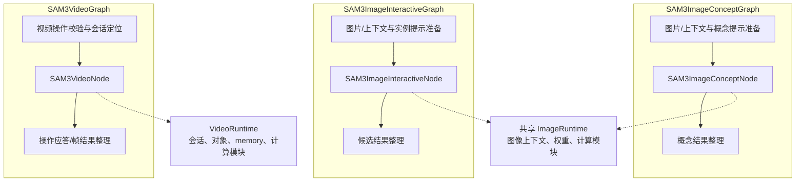

# SAM3 第一版 Graph 划分

> 维护约束见 [开发与维护边界](sam3_development_rules.md)。本文为设计/交接材料；目录外修改须先经用户审核。

日期：2026-11-19。状态：本文为设计依据；三 Graph 已实现，实际验证范围与未完成服务部分见 [实现验收](sam3_graph_validation.md)。

本轮目标：用少量可部署的高层 Graph 提供完整 SAM3 推理能力，同时保留内部 Node 和模块替换边界。HTTP 路由与具体 server 调用方式待服务更新后确定。

## 1. 结论：第一版实现 3 个推理 Graph

| Graph 工作名 | 业务职责 | 输入范围 | 输出范围 |
| --- | --- | --- | --- |
| `SAM3ImageConceptGraph` | 图片概念分割 | 图片/图片上下文、文本、正负概念框、筛选配置 | 多实例 mask、bbox、概念分数、结果引用 |
| `SAM3ImageInteractiveGraph` | 图片实例交互与精修 | 图片/图片上下文、提示组、正负点、实例框、上一轮精修数据/引用 | 每组的候选 mask、质量分数、后续精修引用 |
| `SAM3VideoGraph` | 视频概念发现、实例修正、多目标跟踪与传播 | 视频来源或会话引用，以及明确的业务操作及其参数 | 会话/操作应答、提示帧结果、传播结果或结果引用 |

这是 **3 个 Graph 类型**，不等于 3 个 HTTP 路由、3 个进程、3 份独立权重，也不限定只允许 3 个会话。

图片概念和实例两个 Graph 的提示语义、结果结构不同，独立后更易复用和验证。它们通过同一 ImageRuntime 复用图片上下文，避免切换 Graph 时重复加载模型或丢失图像特征。

视频概念发现和实例修正使用同一 VideoRuntime/session，保留对象 ID、tracker、memory、动作历史和缓存。首版不另设两个各自维护状态的视频推理 Graph。

## 2. 与三组业务接口的对应关系

上一轮的“图片分割、视频交互、视频离线任务”是调用方使用方式。本轮的 Graph 按推理职责划分，两者不要求数量或名称一一对应。

| 对外业务入口 | Graph 复用关系 |
| --- | --- |
| 图片分割，概念模式 | `SAM3ImageConceptGraph` |
| 图片分割，实例交互模式 | `SAM3ImageInteractiveGraph` |
| 视频交互 | `SAM3VideoGraph`，跨调用保留会话 |
| 视频离线任务 | 任务编排器调用同一 `SAM3VideoGraph`，管理场景和会话生命周期 |
| 旧 `/imageMask` | 旧请求/响应适配 + `SAM3ImageInteractiveGraph` |
| 旧 `/videoMask` | 旧任务/场景/导出适配 + `SAM3VideoGraph` |

不为文本、框、点、mask、传播方向、清除提示或查询结果分别创建 Graph。概念后精修通过已有 Graph 的上下文与结果引用衔接，也不必新增一个必选 Graph。

视频离线任务可以有工作流模板。如果之后确实需要在编辑器中将“场景循环 + 推理 + 导出”作为整体复用，再增加 `SAM3VideoTaskGraph` 编排外壳；它不是第一版必须新增的第四套推理实现。

## 3. 第一版实际 Node 结构

图中的名称为设计工作名。已有输入/输出组件能满足契约时优先复用，不要求新增同名类。

每个 Graph 的第一版实际边界是：**输入准备 → 业务推理 → 结果整理**。业务推理 Node 内部通过明确的模块接口调用原生 PyTorch，不把模型所有代码复制进 Graph。

### 输入准备 Node

- 解析媒体/上下文引用，校验本次操作及提示。
- 统一原图/原帧尺寸、坐标和提示标签；区分概念框与实例框。
- 同图复用时定位已有 ImageContext，不无条件重新解码和编码图像。
- 视频控制操作只做操作校验和会话定位，不在每次 run 中重新加载视频。

输入解码及预处理需要有独立函数/适配接口与计时点；是否进一步拆成多个注册 Node，按后续优化需要决定。

### 业务推理 Node

- 图片概念 Node：文本/概念框查询、提示状态更新、多实例推理。
- 图片实例 Node：点/实例框/logits 交互、提示组与候选关系、连续精修。
- 视频 Node：有限且有类型约束的操作集合，如建立会话、设置概念、实例修正、传播、目标管理、重置和关闭；不接受任意内部函数名调用。
- 模型与状态由 Runtime 管理，Node 不为每次 run 新建一份模型。

### 结果整理/导出 Node

- 恢复坐标，整理 mask、bbox、分数、对象/候选标识和结果版本。
- 按需要输出原始业务结果、压缩 RLE 或产物描述；一次操作不必总是写文件。
- 视频传播结果采用分批结果或结果引用，避免把整段视频的全部 GPU mask 一直留在内存里。
- 结果编码与文件导出复用公共组件。工作流需要独立导出时接 `MaskResultExportNode`，不建立额外模型 Graph。
- 视频长操作向 server 的结果传递方式待部署确定；上述结构不代表当前 server 已具备某种流式 Graph 协议。

## 4. 保留哪些内部 Node/模块边界

第一版不要求将以下每一项都注册成可拖拽 Node，但必须保留独立调用边界、输入输出契约及观测位置。它们是后续拆 Node 或替换后端的依据。

| 内部边界 | 第一版职责 | 后续可进行的优化 |
| --- | --- | --- |
| 媒体解码与预处理 | 像素/帧源、尺寸与坐标变换、设备搬运 | 解码流水线、搬运与计算重叠 |
| VisionEncoder | 输出概念和实例/跟踪所需的完整多尺度特征 | 编译/引擎替换、精度调整、特征缓存 |
| TextEncoder 与概念提示编码 | 分词、文本特征、正负几何提示编码；分别保留观测 | 文本缓存、编码模块优化 |
| ConceptGrounder 与 MaskHead | 概念查询、框/分数、概念 mask；可分别观测 | 静态/动态 shape 优化、引擎融合 |
| InstanceSegmentor | 实例提示编码、候选 mask、质量分数和 logits | 提示/候选批处理、解码器替换 |
| MemoryAttention | 用历史 memory 条件化当前特征 | 注意力与缓存读优化 |
| MemoryEncoder | 按最终选定 mask 生成新 memory | 编码器优化、缓存写入优化 |
| Association / TrackingController | 检测-跟踪关联、对象管理、状态更新顺序 | 关联数值计算优化；保留状态语义 |
| 后处理与结果编码 | resize、输出筛选、mask 运算、RLE、bbox | GPU 后处理、CPU 编码并行 |

“保留边界”不能只有类名或一张未来拆分图。至少要落下以下内容：

1. **可调用边界**：围绕现有原生方法建立薄适配，可独立观测和替换，不重写 checkpoint 参数结构。
2. **数据契约**：shape、dtype、device、坐标变换、特征分支、logits/概率/二值含义、结果可用时机。
3. **状态契约**：谁持有上下文/缓存、输入是否被修改、何时失效，替换后端对已有状态有什么影响。
4. **测量入口**：调用次数、工作量/shape、缓存命中、可测的 CPU/GPU 时长；保留 Graph 端到端时长，不将嵌套耗时相加。

例如，后续替换视觉编码器时，两条图片 Graph 的业务输入和输出保持稳定，Runtime 改用满足同一特征契约的新实现。是否能复用已有上下文必须依据模型/精度/后端版本判断，不能无条件保留旧缓存。

视频仍由原控制器维持检测、跟踪、关联和 memory 更新的顺序。第一版不把时序循环强行摊成一个庞大的静态 DAG，也不把每次 memory 读写都暴露为用户节点。

## 5. Runtime 和状态生命周期

| 对象 | 生命周期与所有权 |
| --- | --- |
| ImageRuntime | 由同一服务/Worker owner 持有，两个图片 Graph 注入同一引用；加载图片概念与实例交互所需模型 |
| ImageContext | 对应一张图片及其提示/结果版本；跨两个图片 Graph 使用；一次性调用可自动释放，多轮交互显式保留 |
| VideoRuntime | 持有视频模型及会话管理；会话结束不等于销毁整个模型 |
| VideoSession | 一个视频的交互状态；跨 Graph.run 调用保留，直到关闭、重置或约定的失效条件 |
| Task | 外层任务状态，持有自己创建的会话与产物引用；负责场景循环、失败/取消收尾 |

首版采用简单明确的 owner 约束：需要共享图片上下文的两条图片 Graph 位于同一 owner，同一视频会话始终路由到原 owner。每个 Runtime 的有状态推理先串行执行；增加多 Worker 或并发前再验证状态隔离。

这是一项部署设计要求，不是声称当前 server 已经自动跨 Graph/Worker 共享模型。若部署机制会为两个 Graph 创建独立进程，就不能直接传图片上下文引用，需先调整承载方式。

图片和视频模型是否共享同一个权重实例不在第一版承诺中。共享一个图片 Runtime 也不代表只加载一份模型即可自动支撑全部视频功能。

概念更新可能重置视频对象与跟踪状态，实例修正则应继续使用原会话。两类操作即使在同一个 Graph 中也必须显式区分。

取消控制不能排在被取消的长传播之后才执行。外层可及时设置取消请求，由状态 owner 在安全边界停止并清理；取消后能否继续该会话需验证并写入契约。

## 6. 视频离线与 SAM2 兼容怎样复用

完整 SAM3 离线任务：外层准备视频/场景 → 为场景建立会话 → 注入概念或实例提示 → 调用传播 → 导出 → 关闭自己创建的会话。

持续视频交互：调用方跨多次操作使用同一会话，修正后可继续传播；每次 Graph.run 返回时不自动关闭会话。

两者调用相同的视频推理核心，只是会话所有权和结束时机不同。

旧 `/videoMask` 在外层保留单目标 0、scenes 隔离、无 seed 场景补零、只输出指定场景帧及旧回调/文件格式。无 seed 补零无需调用模型，不为它建立推理 Graph。

旧 `/imageMask` 通过图片实例 Graph 返回结果，再由兼容适配选择/输出单 mask，保留旧字段和响应。概念模式不冒充旧实例框模式。

下载上传、HTTP 响应、回调、任务准入和默认文件命名由服务/任务适配负责。模型推理 Graph 不接收存储凭证或公司回调地址。

## 7. 第一版落地顺序

1. 定义图片上下文、视频会话、提示与结果的最小契约，以及三个 Graph 的输入/输出类型。
2. 建立 ImageRuntime/VideoRuntime 和薄模块适配，保留原生权重加载与推理顺序；不先实施引擎优化。
3. 完成两条图片 Graph，验证概念多实例、实例候选、同图概念后精修及特征复用。
4. 完成视频 Graph，验证概念发现、指定对象修正、多目标、正反向传播、会话持续性及真实取消。
5. 用同一视频 Graph 接通离线任务，再补旧协议兼容。这里与 server 的具体调用衔接待部署明确。
6. 补齐端到端与内部模块测量，基于实际瓶颈选择下一步替换模块。

验收不只检查 Graph 能运行：同图切换 Graph 时上下文应正确；视频连续修正时对象与 memory 应延续；重置后旧结果引用应按规则失效。既有原生迁移对照是回归参考，不等于这些 Graph/服务行为已经验证。

本设计与现有功能范围保持一致：不减少概念分割、多目标和持续交互能力；只控制第一版 Graph 数量与实现复杂度。
