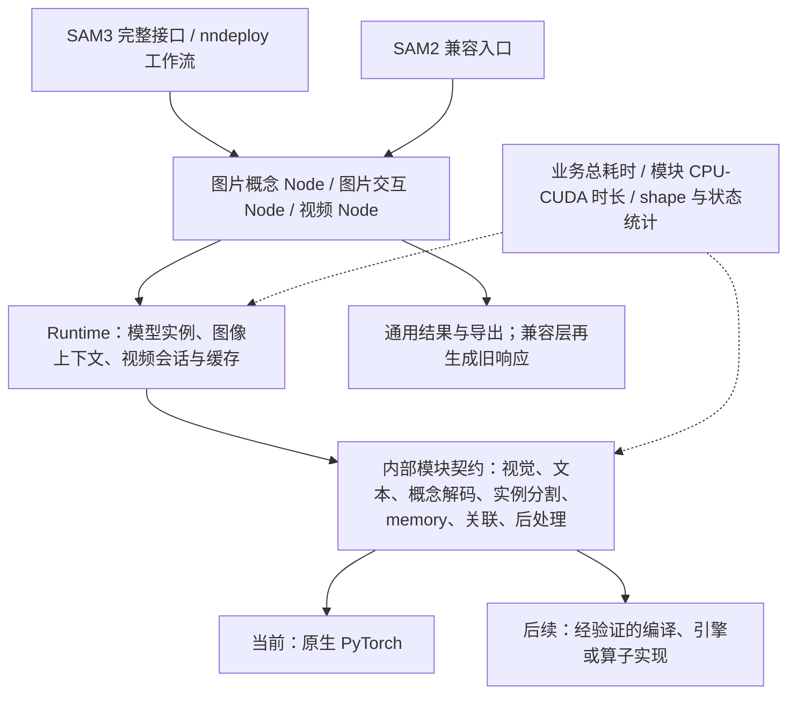

# SAM3 完整能力与内部模块边界 v2

> 维护约束见 [开发与维护边界](sam3_development_rules.md)。本文为设计/交接材料；目录外修改须先经用户审核。

日期：2026-11-18。状态：本文保留设计与能力范围；业务 Graph/Node、Runtime 已实现，专用服务接口未完成，见 [实现验收](sam3_graph_validation.md)。
本文件替代同目录第一版节点边界设计中对 SAM3 业务范围的定义。

源码依据：本仓库 `chenze` 分支，提交
`b7286d190c61362553ddca1d3628a3913e1f124d`。原生模型来源为 SAM3
`ae8591cc61ee4582f8ba7b0ed07f78de376e2462`。本项目不扩展到 SAM3.1。
协议参考：用户提供的 SAM2 API 文档，原文件不随本仓库分发。

## 1. 修正范围与总体原则

上一版按旧 `/imageMask` 和 `/videoMask` 划定首批模型节点，把概念分割、多目标发现放在后续扩展，范围不完整。
同时，逐任务/逐场景关闭会话仅适合旧离线任务，不能成为所有 SAM3 视频调用的固定生命周期。

修正为：

1. SAM3 原生的概念分割、实例交互、视频概念发现与跟踪、多目标修正都需要形成可用接口。
2. SAM2 文档约束旧服务兼容入口，不限定完整 SAM3 接口只能使用框/点、单目标、目标 0 或一次性任务。
3. 对外保持业务节点；对内通过 Runtime、计算模块、数据与状态契约，保留可测量和可替换边界。
4. 业务 Node、HTTP 接口、内部模块和后端执行引擎不要求一一对应。
5. 当前原生 PyTorch 推理作为第一实现。先增加薄适配与观测，不重写跟踪算法、不立即导出引擎或开展算子优化。

## 2. 完整能力清单

| 能力组 | 需要提供的用户能力 | 源码依据与限制 |
| --- | --- | --- |
| 图片概念分割 | 文本查询；同图正/负示例框；文本与示例框组合；返回多个匹配实例的 mask、box、分数 | `Sam3Processor.set_text_prompt`、`add_geometric_prompt`；不能缩成只返回一个目标 |
| 图片概念上下文 | 载入图片后复用视觉特征；更换文本、追加示例框、清除提示、调整输出阈值 | `set_image`、`reset_all_prompts`、`set_confidence_threshold`；缓存按图像与提示版本管理 |
| 图片实例交互 | 正负点、实例框、点框组合、低分辨率 mask logits 修正；单候选/多候选及质量分数 | `Sam3Image.predict_inst`、`SAM3InteractiveImagePredictor.predict`；候选数与概念检测出的目标数不同 |
| 图片组合流程 | 概念分割后选中一个结果，基于同图上下文、所选实例框与点击继续修正 | 两条分支保持区别，不声称它们共享同一套提示编码器或解码器 |
| 视频概念分割 | 文本、正负概念示例框、文本+概念框；发现并持续跟踪多个匹配目标 | `Sam3VideoInference.add_prompt` 与完整传播；视频框在该入口属于概念提示 |
| 视频实例交互 | 指定 obj_id 的点击修正；完整帧 mask 初始化/修正；多个目标、多个关键帧 | `add_tracker_new_points`、`add_tracker_new_mask`；旧服务的所有 seed 目标 0 仅是兼容规则 |
| 视频组合流程 | 概念发现 → 选择 obj_id → 在同一 session 中点击/mask 修正 → 继续传播 | 不丢弃已建立的 ID、tracker、memory 与动作历史 |
| 视频传播 | 前向、后向、双向；起始帧、传播范围；返回逐帧对象 ID、mask、box、分数 | 区分完整传播、局部传播和读取缓存；不将缓存读取计为新计算 |
| 会话与目标管理 | 创建、重置、关闭；移除目标；取消运行中的传播 | 模型 shutdown 属于 Runtime/Worker 生命周期；取消的原生缺口见第 7 节 |
| 批量运行 | 多图片/多任务请求能够使用以上能力；可逐项正确执行，再增加真正批计算 | 原生有 `set_image_batch`、`predict_inst_batch`，不能推定所有 processor 方法已支持批次 |
| 结果输出 | 图片多实例、实例多候选、视频多对象、原始分辨率与帧号、合适的分数字段；RLE/文件导出 | 完整 SAM3 结果不受旧 RLE 单目标响应结构限制 |

图片概念框、图片实例框、视频概念框是不同契约：当前原生接口分别使用归一化 cxcywh、像素 xyxy、归一化 xywh。
图片实例 mask_input 是低分辨率 logits，视频 seed mask 是原帧分辨率二值 mask，不互相替代。
视频 `_get_visual_prompt` 当前要求初始 visual prompt 只有一个框；框带正负 label 并不意味着高层入口允许任意数量的初始示例框。
图片与视频概念框的数量限制需要分别描述，不能直接复用相同的“框列表”承诺。
视频高层当前没有独立的“指定实例 bbox 修正”入口；不能因为 tracker 底层存在点框工具就把它列为已接通功能。
跨图示例、任意新提示组合等未被当前入口证实的能力，也不能以“完整 SAM3”为名直接承诺。

## 3. 对外业务节点

推荐 **3 个主要业务 Node + 1 个通用结果导出 Node**。
概念、实例是四类图片/视频能力，但视频的两类操作由同一个状态化视频业务 Node 提供，保持会话一致。
名称为工作名；本阶段不冻结 URL、请求 JSON 或 Python 函数签名。

| 节点 | 业务职责 | 状态和输出 |
| --- | --- | --- |
| `SAM3ImageConceptNode` | 图片文本/正负示例框概念分割，返回全部匹配实例，支持同图连续提示 | 使用 ImageRuntime 的图像上下文；输出 N 个实例及概念分数 |
| `SAM3ImageInteractiveNode` | 图片实例点/框/低分辨率 mask 交互，支持概念结果选中后的精修 | 可复用同一图像上下文；输出提示组对应的候选 mask、质量分数和低分辨率 logits |
| `SAM3VideoNode` | 视频概念发现、实例初始化/修正、传播与对象操作 | 所有操作使用同一 VideoRuntime/session；输出逐帧多对象结果或操作应答 |
| `MaskResultExportNode` | 多实例/多对象结果的 RLE、JSON、CSV 等编码与本地产物输出 | 通用导出保留对象信息；旧协议字段和单目标视图由兼容适配生成 |

视频 Node 有明确的概念提示、实例提示、mask 提示、传播等操作类型，不是接受任意方法名的反射入口。
同一个视频 session 的操作落到同一个 Runtime。无需把 start/add/propagate/close 都做成独立模型 Node。
如果后续 UI 需要“视频概念分割”和“mask 跟踪”两个可拖拽入口，可提供两个业务 Graph/薄门面，内部仍绑定同一类 Runtime。

模型与会话驻留不等于所有请求都创建一个模型。Runtime 由承载它的 Graph/Worker 管理，业务 Node 使用已有 Runtime。
共享代码、共享视觉特征格式，不代表图片模型和视频模型已经共享同一个权重实例；跨模型实例共享需要后续单独实现与验证。

## 4. Graph 和服务入口

2026-11-19 补充：第一版实际建议实现 **3 个推理 Graph**：图片概念、图片实例交互、视频分割与跟踪。完整划分与内部边界见 [首版 Graph 划分](sam3_graph_design.md)。

以下清单表示必须覆盖的业务用法，不表示七个都要实现为独立 Graph 类。概念后精修复用两条图片 Graph；视频概念/实例共用视频 Graph；SAM2 兼容和视频离线任务在外层适配与编排。

完整能力至少覆盖以下工作流：

- 图片概念分割 Graph：图像来源 → 概念 Node → 多实例结果/展示/导出。
- 图片实例交互 Graph：图像或图像上下文 → 交互 Node → 候选结果/展示/导出。
- 概念选中后精修 Graph：概念结果选择 → 对应上下文与实例框/提示 → 交互 Node。
- 视频概念分割 Graph：建立会话 → 概念提示 → 传播；交互模式保留会话，离线任务模式由编排关闭。
- 视频实例跟踪 Graph：关键帧 mask/点击、指定对象 → 传播与修正；支持多个对象。
- 旧 SAM2 图片兼容 Graph/适配：调用图片交互能力，生成单目标 `code/msg/size/counts`。
- 旧 SAM2 视频兼容 Graph/适配：按 scenes 隔离会话，所有 seed 作为目标 0，补零和文件格式按旧文档处理。

“没有 mask 的场景补零”和“必须有至少一个 mask seed”只适用于旧视频兼容流程。
SAM3 视频概念分割可以从文本/概念框启动，不应被这些旧规则拒绝或变成全零输出。
类似地，“scene 结束关闭 session”是离线编排策略；持续交互会话在多次调用之间仍然有效，直到显式关闭、重置或规定的失效条件。

HTTP 路径、同步/异步、回调、busy/排队、对象存储配置留在服务层。
SAM2 根路径和旧响应由兼容门面提供；完整 SAM3 接口与工作流调用相同业务逻辑，不要求旧调用方增加新字段。
旧服务默认回调/重试等差异与适配责任延续第一版的协议映射，但第一版不再定义完整 SAM3 的能力范围。

## 5. 对内计算模块边界

以下是内部逻辑边界，不意味着每一行都成为前端 Node、独立进程或单独 ONNX/TensorRT 文件。

| 模块 | 职责与可替换契约 | 当前自然入口 |
| --- | --- | --- |
| 媒体解码 | 文件/帧源 → 原分辨率像素与帧标识；支持替换解码实现 | `io_utils` 的读图/读帧路径 |
| 预处理与数据搬运 | 颜色、尺寸、归一化、布局、dtype、device 与坐标变换元数据 | processor transform、视频 IO 预处理 |
| Tokenizer / TextEncoder | 文本 → token → 语言特征和 mask；CPU 分词与 GPU 编码可分别测量 | `SimpleTokenizer`、`SAM3VLBackbone.forward_text` |
| VisionEncoder | 像素 → 概念分支和实例/tracker 所需的多尺度特征与位置编码 | `SAM3VLBackbone.forward_image`、ViT、neck |
| ConceptPromptEncoder | 正负概念框及相关提示 → 几何/提示特征 | `Sam3Image._encode_prompt`、geometry encoder |
| ConceptGrounder | 视觉、语言、概念提示 → encoder/decoder 查询、框和得分 | `_run_encoder`、`_run_decoder`、评分头 |
| ConceptMaskHead | 概念查询与图像特征 → mask 预测 | `_run_segmentation_heads` |
| InstanceSegmentor | 实例提示与图像/时序特征 → 候选 mask、质量分数、logits | SAM prompt encoder、mask decoder、`_forward_sam_heads` |
| MemoryAttention | 按选择的历史 memory 条件化当前帧特征 | `_prepare_memory_conditioned_features`、memory transformer |
| MemoryEncoder | 当前帧特征与最终 mask → 新 memory 特征和位置编码 | `_encode_new_memory` |
| AssociationOps / TrackingController | 检测与 tracker 关联、对象生命周期、更新计划与状态提交 | `_associate_det_trk`、tracker update planning/execution |
| 后处理 | resize、阈值、孔洞/重叠处理、输出筛选与坐标恢复 | 图片 processor、视频 `_postprocess_output` 和 mask 工具 |
| 编码与导出 | 二值结果 → RLE/文件，mask → bbox | 通用结果导出与编码辅助 |

概念几何提示编码与实例 prompt encoder 是不同模块；概念 decoder 与实例 mask decoder 也分别保留边界。
视频全量推理先运行 backbone/Detector，复用帧特征供 tracker 使用，再进行关联与更新计划，最后执行必要的 memory 写入。
不能只看神经网络层就删除更新控制器，也不能把 memory 写入移到关联/最终 mask 确定之前。

第一实现围绕原有方法做适配和观测，保留参数名、checkpoint 加载和推理控制流程。
计算模块替换尽量不改变 TrackingController 的状态提交规则。CUDA/Triton 掩码算子、关联数值计算等可独立替换，但必须保持调用顺序与结果语义。
物理引擎可以融合多个逻辑模块；融合后不能测到的内部耗时要明确标注，不能强制拆引擎或虚构分段时间。
将来接入引擎时评估复用 nndeploy 的推理后端抽象；当前接入一个原生模型不需要新增推理后端枚举。

### 模块契约必须写清的内容

- 张量 shape、dtype、layout、device，以及动态维度含义。
- 图像原尺寸、模型尺寸、resize/pad/坐标变换；box 格式与坐标空间。
- 特征 bundle 包含哪些分支、哪些高分辨率特征、是否已做 projection；不能只输出一个 embedding 就称等价。
- logits、概率、二值 mask 的区别。当前图片概念输出名 `masks_logits` 实际保存 sigmoid 后概率，适配层不得继续模糊其含义。
- 概念置信分数、实例 mask 质量分数、视频 tracker 分数分别标明，不混为一个通用 confidence。
- 输入是否可变、输出/缓冲区由谁持有、能复用到何时，是否与其他特征共享存储。
- CUDA stream 和输出可消费的时机；异步实现不能让下游提前使用尚未完成的输出。
- 模型版本、权重、预处理、精度和后端版本，与缓存是否匹配。

首阶段可以只有一套 NativeTorch 实现。接口和测试固定之后再替换某个模块，避免为所有未来后端预先编写空实现。

## 6. 状态、缓存与测量

### 状态所有权

| 状态 | 负责者 | 生命周期 |
| --- | --- | --- |
| 权重、计算模块、设备资源 | Runtime，由 Graph/Worker 承载 | 初始化至 owner 关闭；业务 Node 不擅自销毁其他节点还在使用的 Runtime |
| 图片特征、图像变换、提示与结果版本 | ImageRuntime 中的 ImageContext | 单次请求或显式图片上下文；同图多次概念/实例交互可复用 |
| tracker、object IDs、memory、帧缓存、动作历史 | VideoRuntime 中的 VideoSession | 持续交互期间跨调用保存；reset/close 时处理；离线 Graph 自主管理场景会话 |
| 临时计算张量与结果快照 | 当前操作及结果持有者 | 操作结束/结果释放；输出不能依赖已关闭 session 的惰性生成器 |

同一视频 session 的概念发现和实例修正必须命中同一 owner。首版可使用单 Worker，保证顺序执行；多 Worker 时必须补齐 owner 路由，不能把 session_id 发送到任意 Worker。
图片概念结果只能作为该图像/结果版本内的选择依据；其结果序号不等于视频跨帧 object ID。
会话 ID/图像上下文引用可以作为业务数据传递；GPU 模型、原始 tracker 状态和缓存不能作为公共 JSON 或跨进程序列化载荷。
Node 参数序列化稳定配置，Runtime 注入保留运行时资源，二者分开管理。

源码中的视频概念提示会 reset 原任务状态；实例点击则修正指定 obj_id，二者不能在一次原生 add_prompt 中混用。
因此完整接口必须表达“建立/更换概念查询”和“修正现有目标”的区别，更新状态版本并使旧结果引用失效。
图像提示变化不必使视觉特征失效，但依赖提示的编码、结果缓存需要按版本更新。
同一视频 backend 或精度切换默认在新会话/重置边界生效，已有 memory 不无条件迁移复用。

### 测量边界

| 层级 | 至少记录的内容 |
| --- | --- |
| 业务调用 | 等待、输入准备、推理、导出、总耗时；冷加载与暖态运行分开 |
| 计算模块 | CPU 发起/控制时间、可测的 CUDA 执行时间、调用次数、输入输出 shape、dtype 与字节数 |
| 会话与缓存 | 图像/帧特征命中，文本特征命中，实际检测与 tracker 调用次数，读取/写入 memory 的规模 |
| 动态工作量 | 提示组数、每组候选 mask 数、检测保留数、跟踪对象数、实际输出对象数、memory 长度，逐项区分 |
| 视频路径 | propagation_full / partial / fetch，实际计算帧与读取缓存帧，正反向及对象范围 |
| 显存 | allocated/reserved、峰值及测量作用域；不能把嵌套模块的峰值或耗时直接相加 |

观测应可关闭/按需启用。CPU 计时不冒充 GPU 完成耗时，不为默认运行逐模块同步 CUDA。
复用已有 `torch.profiler.record_function` 等区域；详细 profiling 时再使用 CUDA events、Profiler 或专门工具。
父模块时间包含子模块时明确 inclusive/exclusive；业务延迟、GPU 时间、内核明细分别解释。
保留完整 Node 的端到端指标，不能用单模块提速直接推导用户任务提速。

## 7. 当前实现状态与必须补齐的能力

- 原生迁移和 Graph/Node/Runtime 已完成对应验证；专用服务实现仍待后续。本文下述原生缺口由包内适配补充的状态见实现验收记录，不代表上游原生入口已全部改变。
- 既有 44 组、209 个数组一致的结果是原生迁移回归基线；未覆盖全部新接口和每一种提示组合。
- **取消缺口**：当前 `Sam3BasePredictor.cancel_propagation` 仅在模型存在同名方法时调用；已迁模型中没有该实现，外层仍返回成功。需要在运行时/传播循环实现可验证的协作取消，不能把“收到成功应答”当作“GPU 传播已停止”。
- 取消不能排在被取消的长传播任务之后才处理；控制路径只设置停止请求，状态释放由 owner 在安全边界执行。取消后是否可直接继续传播需给出明确契约并验证。
- **参数缺口**：外层 add_prompt 暴露的 `clear_old_points`、`clear_old_boxes`、`output_prob_thresh` 会按模型签名过滤；当前视频模型不接受这些参数。完整接口需要逐项实现或明确拒绝，不得默默接受却无效果。
- 输出过滤阈值与决定检测/跟踪行为的算法阈值应区分，不能用一个参数同时宣称控制两种含义。
- **批量缺口**：set_image_batch 存在不代表 set_text_prompt 已支持批次。当前概念后处理读取单图 original_height/width，而批图状态记录复数尺寸字段；先提供正确的批任务语义，再接通批计算并回归。
- 多 Worker 会话路由、连续交互时状态隔离、后台取消、全部负提示组合尚未作为当前交付验证完成。
- 图片单候选选择、bbox 端点、多关键帧重叠结果处理等旧协议未定义项继续在契约阶段明确；这些不会将完整 SAM3 限制为旧单目标能力。

## 8. 后续开发顺序与验收

1. 冻结完整能力矩阵、业务操作和内部数据/状态契约，确定取消与失效规则。
2. 实现薄 Runtime 和三个业务节点，使用原生 PyTorch，覆盖图片概念/交互、视频概念/多对象交互，保留测量入口。
3. 完成概念选中后精修、跨调用同会话修正、正反向传播、重置/关闭/真实取消的端到端验证；验证语义而不只检查接口返回成功。
4. 接入工作流与完整 SAM3 服务接口，单独补 SAM2 兼容门面和导出；两套入口共享业务实现。
5. 在固定样例上补全负提示、多对象、多关键帧、空结果、缓存命中/失效、批任务和连续会话的验收。
6. 再基于模块与端到端测量选择替换目标。每个优化模块用同一输入/状态做对照，并验证完整视频轨迹、对象 ID 和状态更新；近似后端的容差需明确约定。

不因代码里出现 compile、分布式或低层算子名称，就把它列为已完成的接口能力或已验证的优化效果。
本文仍为设计材料，不表示业务节点或服务适配已经实现。
