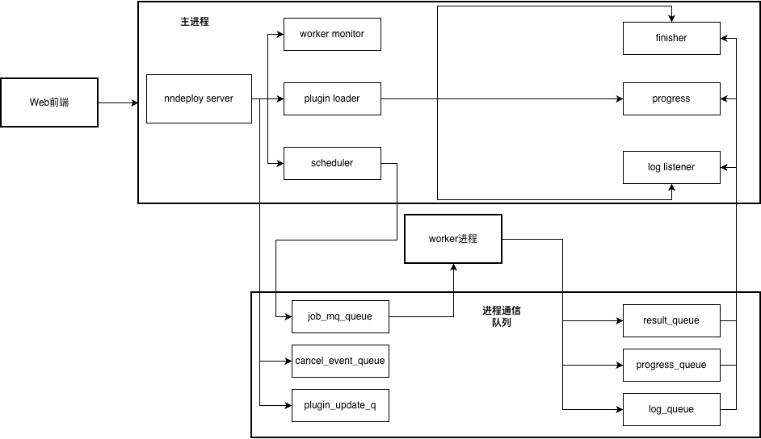

# nndeploy后端架构与实现文档

## 项目概览

nndeploy的后端基于 *FastAPI* 实现，向前端提供 RESTful API 与 WebSocket 实时通知，承担资源下载/管理、任务调度、任务执行以及消息推送等职责。

当前开发分支同时提供可在代码中创建的 `nndeploy.server.Server`；原 `NnDeployServer` 名称和编辑器入口保持兼容。新增调用路径复用 Server、TaskQueue、Worker 和 GraphRunner，以入口为单位独立排队。

## 直接使用本地文件

Deploy 的图片、文件、NumPy 和音频文件输入支持 `{"path":"resources/input.jpg"}` 或直接传路径字符串，无需先上传。也兼容将本地路径放入 `file_id` 的旧调用写法；真正的 `file_...` 标识仍按已有上传文件解析。

```bash
curl -X POST http://127.0.0.1:8000/v1/server/Classification_ResNet/deploy \
  -H 'Content-Type: application/json' \
  -d '{"inputs":{"OpenCvImageDecode_27":{"path":"resources/template/nndeploy-workflow/detect/zidane.jpg"}}}'
```

路径指 Server 所在机器的文件，相对路径以启动目录为基准，绝对路径也可用。请求会检查文件存在、类型和大小，执行时直接读取原文件，不上传、不移动、不删除输入。排队期间应保留该文件；多个机器上的 Worker 使用此方式时需能访问同一路径。输出仍通过返回的文件 ID 下载。

## 按节点覆盖请求参数

Deploy 请求直接以节点名作为顶层字段，不需要 `inputs` 或 `parameters` 包装。Server 面板的 **Public request fields** 可逐字段选择允许调用者修改的配置；点击 Start / Update 后生效并保存到现有 `.server.json`。新建服务默认只勾选输入节点的路径或文本字段，其他字段由用户选择；已有服务保留原开放范围。例如勾选分类后处理的 `param_.topk` 后：

```bash
curl -X POST http://127.0.0.1:8000/v1/server/Classification_ResNet/deploy \
  -H 'Content-Type: application/json' \
  -d '{"OpenCvImageDecode_27":{"path_":"resources/template/nndeploy-workflow/detect/zidane.jpg"},"ClassificationPostProcess_24":{"param_":{"topk":3}}}'
```

一次请求可以覆盖多个节点，仅传需要修改的字段；未传字段使用工作流默认值。未勾选字段不能通过请求修改，旧版包装格式也执行同样检查。取消输入节点路径或文本字段的勾选后，调用会使用工作流配置的固定输入。普通节点使用节点名，嵌套节点使用接口返回的完整字段名（例如 `inner_prefix`）。Server 面板的 Parameters 展示可用字段及默认值。输入节点的 `path_` / `str_` 也可在这里传入；输出节点的 `path_` 可以指定本机输出文件，并仍返回可下载的文件 ID。

覆盖只对本次请求生效，不改写工作流 JSON。存在实际参数变化时，在 Worker 内重新初始化 Graph，使模型、设备、预处理等初始化阶段读取的配置生效；请求结束恢复原配置与初始化状态，因此参数变化可能增加调用耗时。节点名称、类型标识和连线属于图结构，不作为请求参数。自定义 Python 节点需通过已有 `serialize` / `deserialize` 读写其可配置字段；未序列化的 Python 属性不会自动暴露。代码 Graph 和 Graph 工厂自动生成接口时遵循相同规则。已有编辑器 Server 点击 Update 后会补全节点参数，并同步当前工作流默认值。

代码配置也可在已有 `parameters` 节点声明中设置 `exposed`，例如 `"exposed": [["param_", "topk"]]`。`[]` 表示不开放任何字段；省略则兼容原有开放范围。公开接口描述只展示允许修改的默认值。同步、异步、流式请求以及 batch 的每个 item 都支持顶层节点写法，原 `mode` 等请求选项继续可用。

## 任务完成回调

Deploy 请求可在节点字段旁传入 `callback_url`。同步、异步、流式请求均支持，batch 在每个 item 内指定地址；常用方式是 `mode: "async"`，立即返回任务 ID，完成后接收通知：

```bash
python demo/server/callback.py
# 在另一个终端调用：
curl -X POST http://127.0.0.1:8000/v1/server/Classification_ResNet/deploy \
  -H 'Content-Type: application/json' \
  -d '{"mode":"async","callback_url":"http://127.0.0.1:9000/callback","OpenCvImageDecode_27":{"path_":"resources/template/nndeploy-workflow/detect/zidane.jpg"}}'
```

Server 向指定地址发送 HTTP POST JSON，包括 `event: "task.finished"`、`task_id`、`request_id`、`name`、`state`、`outputs`、`error` 和 `finished_at`。成功、失败、取消、过期等终态都会通知；请求在任务接收前被拒绝则不通知。文件结果保持 `file_id`，通过原文件下载接口读取。

接收端返回任意 2xx 表示成功。网络错误或非 2xx 最多尝试 5 次，正常失败后的重试间隔为 1、5、30、120 秒；不跟随 HTTP 重定向。回调在独立后台执行，失败不会修改模型任务结果。`GET /v1/tasks/{task_id}` 的 `callback` 返回地址、投递状态（pending/delivered/failed）、尝试次数、最近 HTTP 状态码和错误。

回调随任务一起入库，同一工作区重启后继续发送待完成通知；多实例通过数据库领取投递。崩溃或响应丢失可能产生重复通知，接收端应按 `task_id` 去重；请求头也包含 `X-NNDeploy-Task-ID`。通知未完成时保留任务记录及文件引用，避免自动清理先删除结果。修改回调地址后不能复用原幂等键。

地址必须是 Server 能访问的 HTTP(S) URL，可使用本机或内网接收端；不接受 URL 用户名、密码或 fragment。Server 不转发调用者凭据，也不读取回调响应正文。独立工作区各自负责其接收请求的回调，源工作区停机期间等待它恢复。没有配置回调的请求保持原行为。

## 音频采样输入输出

安装可选依赖 `pip install 'nndeploy[server-audio]'`，上传校验还需要系统 `ffprobe`。数值字段沿用 `array` / `tensor`，声明 `dtype="float32"`、`sample_rate` 和 `media_type`，输入输出继续使用 `{"file_id":"..."}`。Server 自动解码、重采样和声道转换，算法只读写 NumPy 数组或原生 Tensor。运行 `python demo/server/audio.py --isolation process` 验证普通 Graph 的完整上传、Deploy、下载链路；调用示例见 [Audio Graph](../../../demo/server/README.md#audio-graph)。

形状为 `[frames]` 或 `[frames, channels]`，帧数可为 null，声道数固定为 1–8；Tensor 轴格式可选 N / NC。采样率为 8000–192000 Hz，具体输出编码器还须支持该采样率；MP3 仅支持单/双声道，Ogg 输出使用 Opus。支持 WAV、FLAC、MP3、Ogg 和 M4A 的对应 MIME。WAV 输出保留 float32 数值；压缩输出要求样本在 [-1, 1]，FLAC 编码会量化，有损编码还可能改变幅值及解码帧数，建议使用可变帧维度。固定帧数按实际解码后形状严格检查，不自动补齐或截断。

输入上限为 64 MiB 编码内容、600 秒及字段 max_elements/max_bytes，实际取更严格限制；输出还受文件存储字节上限约束。拒绝非有限样本、混合视频/多流、超限解码、损坏 WAV 长度；这不保证识别所有有损格式的截断。算法输入输出转换在 Worker 内执行，不创建额外转码子进程；准入和最终结果核验还会在父进程线程扫描解码样本。父进程校验没有硬总期限；Worker 中的硬执行期限需要进程隔离，线程模式不能硬中断阻塞原生解码。异步引擎先复制结果，再在线程编码和保存；取消等待实际文件操作结束。预热不发布持久输出，文件沿用身份、Task、保留和对象存储机制。这是整份音频文件与数值端口的转换，不是实时音频协议。

常驻 Graph 启动时复用编辑器的 `resources/plugin`；API-only 使用 `<data_dir>/plugin`。隔离 Worker 会自行加载这些可信节点插件，再反序列化工作流，无需把导入路径写入工作流 JSON。新插件需重新启动 Worker；线程内已导入模块的替换需重启进程。相关文件属于管理员安装代码，不接受普通 Deploy 请求提供的路径。

## 直接启动工作流或代码

```bash
python -m nndeploy.server --api-only --workflow workflow.json
```

API-only 不加载前端、工作流模板和模型下载器；输入输出可以从已有节点识别，或通过同名 `workflow.server.json` 指定。原工作流 JSON 不插入 Server 字段。

```python
from nndeploy.server import Server

server = Server(name="echo", deploy=lambda inputs: inputs)
server.run(host="127.0.0.1", port=8000)
```

调用 `POST /v1/server/echo/deploy`，请求为 `{"inputs":{"text":"hello"},"mode":"sync"}`。`mode="async"` 返回任务 ID；任务状态、最终结果和取消沿用 `/v1/tasks/{task_id}` 及其 `/cancel` 接口。Graph 可以通过 `graph=` 或 `graph_factory=` 接入，多个入口通过同一个 Server 的 `add(...)` 添加。

声明 `streaming.enabled` 的代码生成器还支持 `mode="stream"`。SSE 使用 `start / delta / result / error / done` 事件；最后一次 yield 形成最终输出。任务事件保存在数据库，可通过 `/v1/tasks/{task_id}/events` 和 `Last-Event-ID` 重放，断线不会自动取消计算。可运行代码和调用方式见[流式示例](../../../demo/server/README.md)。

异步算法可使用 `execution.scheduling="engine"`，以 `max_concurrency_per_worker` 限制单个引擎的并发请求；这不会创建同等数量的模型副本。取消仅作用于对应 task_id，仍在计算或清理的请求继续占用名额。示例增加了 `--engine-concurrency` 选项。

代码异步生成器还可声明 `streaming.duplex=true`，通过关键字参数 `input_stream` 在同一个 Task 中持续接收 JSON 片段。先用原 Deploy 接口创建异步任务，再向 `/v1/tasks/{task_id}/inputs` 按序追加输入，或使用 `/v1/tasks/{task_id}/stream` WebSocket 同时收发。输入按序号持久确认和去重，沿用任务鉴权、队列、文件引用、取消及保留策略；默认最多 64 条未消费输入，满额可重试，断线不取消计算。支持本地线程/进程和 Redis 共享 Worker。运行 `python demo/server/duplex.py`，协议、重连和限制见[双向流示例](../../../demo/server/README.md#duplex-input-and-output)。当前提供 JSON 帧通道，具体音视频协议和浏览器客户端鉴权仍需算法接入，不能等同于已有完整实时音视频模型服务。

提供同步 `batch_key` 和 `deploy_batch` 的算法可通过 `execution.batching` 显式启用动态合批。Server 根据形状兼容键、参数和调用身份分组，保持逐条任务、期限、取消及结果校验。每个 Worker 只执行一个批计算，达到 `max_size` 或首条的 `max_wait_ms` 后派发；普通 Graph、进程和流式组合会明确拒绝。CPU 示例：`python demo/server/batch.py`，详细接口见[示例说明](../../../demo/server/README.md)。

默认使用 SQLite 与本地文件；MySQL、PostgreSQL、对象存储、Redis 共享队列和 API key 权限通过配置启用。完整的开发状态、测试证据及未完成项见[实施记录](../../../docs/zh_cn/vibe_coding/always/server_implementation.md)，不能将现有接口等同于六阶段全部完成。

Start/Stop 的重复调用等待当前操作，调用者取消等待不会取消 Server 的初始化或关闭。Reload 先准备新 Worker，再切换请求并排空旧 Worker；排空期间其他控制操作返回冲突。旧 Worker 释放失败时状态保留 `draining_workers`，阻止继续加载。临时 DB 故障时配置提交会重试，其他 Server 修改过配置则返回冲突；关闭时仍无法确认提交结果会报告 `configuration_unconfirmed`，需要在 DB 恢复后检查保存状态。HTTP 控制幂等、已提交及已落盘响应的跨重启恢复见下文；无结果证据的完整崩溃对账仍待实现。

入口的任务消费者异常退出后，该入口拒绝新请求并显示失败，其他入口继续运行。Stop/关闭仍等待实际 Worker 结束，再处理尚未确认结果的任务和释放资源；共享队列只处理本 Server 持有的运行任务，不改写其他实例的执行结果。已写库或已持久保存的结果优先恢复，不能把异常退出记成空的成功结果。若计算已关闭但结果或资源释放无法确认，保留失败状态，不宣称清理完成。

Server 仍运行时，数据库清理失败可在数据库恢复后再次 Stop；已确认关闭的模型不会重复执行 `deinit()`，共享清理始终重试原有归属。失败初始化的清理未确认前，Start 不会覆盖原有文件引用；Reload 候选和旧 Worker 的未完成清理也由同一个 Stop 处理。HTTP 对原幂等键仍重放原结果，重新尝试应使用新的 Stop 请求，编辑器再次点击 Stop 即可。物理释放本身抛错时保留原错误和资源占用，不能靠重复调用将其当成成功；这也不表示已整体关闭、依赖已销毁的 Server 对象可以重新启动。

算法主动抛出 `asyncio.CancelledError` 时，当前任务记录为 `cancelled`，其线程、隔离进程或引擎可继续处理后续请求；动态合批的分组键与批次调用也使用这一规则。它要求算法已经退出实际计算和清理，不允许后台计算继续占用模型却提前返回取消。HTTP 等待者断开或取消不等于算法取消；应通过现有任务取消接口请求终止。内部消费者的等待者取消不改变 Server 对执行的持有，正常停机仍应调用并等待 `Server.close()`，不能用强制关闭事件循环替代。

### 隔离 Worker 的 CPU 线程

可选 `execution.cpu_threads` 限制每个隔离 Worker 中受支持计算库的线程数，例如 `"execution": {"isolation": "process", "cpu_threads": 2}`。默认不设置；普通线程、并发和 engine 模式明确拒绝该选项，避免进程级设置影响其他入口。它限制每个计算库的线程池，不能等同于整个进程最多两个 OS 线程、CPU 核绑定或主机总 CPU 配额。

Worker 在工厂前应用设置，工厂返回后和每次 Deploy 前刷新已加载库；预热、重建与 Reload 沿用相同配置。支持 threadpoolctl 识别的 BLAS/OpenMP，以及已加载的 OpenCV、NumExpr、PyTorch；不为配置线程数额外导入模型框架。OpenCV 若不能满足指定上限（例如 GCD），使用其串行模式，仍不能满足则启动失败。原生 Graph 在 init 前递归限制已有后端参数的 num_thread_，有 inter_op_num_threads_ 时一并限制；较小的已有值保留，原工作流 JSON 不改写。失败 Reload 保留原 Worker。

不支持的计算库、自定义线程、独立加载的另一份原生库和算法主动修改的线程设置不受通用控制。模块导入及工厂内部新加载库的初始化应由算法设置其专属参数；环境变量不能证明已有线程池已被限制。当前本机实测包含 OpenCV GCD、原生 Graph 参数与真实进程恢复；PyTorch、OpenMP/BLAS 后端的线程限制效果仍需对应环境做功能验证；本轮不做 CPU 性能测试。相关语义见 [threadpoolctl](https://github.com/joblib/threadpoolctl)、[OpenCV](https://docs.opencv.org/4.x/db/de0/group__core__utils.html)、[PyTorch 线程配置](https://docs.pytorch.org/docs/stable/generated/torch.set_num_interop_threads.html)。

### 模型与请求的设备预算

可选 `Server(device_limits=...)` 为加入当前 Server 的模型预留实例数及声明的常驻内存。CLI 使用 `--device-limits budgets.json` 读取相同应用配置；没有启用时行为保持不变。工作流配置仍是原有 `.server.json`，无需改动 Graph JSON：

```python
server = Server(device_limits={
    "devices": {"cpu": {"max_workers": 3, "memory_bytes": 268435456}}
})
server.add(name="echo", deploy=lambda values: values, config={
    "inputs": {"text": {"type": "string"}},
    "outputs": {"text": {"type": "string"}},
    "execution": {"devices": ["cpu"], "memory_bytes": {"cpu": 67108864},
                  "temporary_memory_bytes": {"cpu": 16777216}}
})
```

`execution.devices` 声明每个 Worker 使用的完整设备组；`execution.memory_bytes` 是每个 Worker 在对应设备上的预算，按 `workers` 相乘。启用协调后，每个入口必须声明设备；配置了设备内存上限时还必须声明正的内存需求。没有内存上限时可只限制实例数，但内部声明总量仍限制为有符号 64 位整数范围。多设备申请在一个事务内全部满足或全部拒绝；不足返回 503 `device_capacity_exceeded`，不会自动卸载其他入口。声明预算但没有配置协调器会拒绝启动，避免静默忽略预算。

实例名额与内存都在算法工厂、Graph 加载及预热之前预留。Reload 同时计算新旧模型，只有旧 Worker 排空并确认关闭后才释放旧占用；空间不足时旧接口继续工作。串行、并发、引擎和动态合批仍按真实 Worker 实例计数，不把请求并发数当成模型数量。设备预算本身不限制 CPU 线程数（隔离 Worker 可另设 cpu_threads），也不会设置 CUDA_VISIBLE_DEVICES、迁移 Graph、查询真实显存或自动验证算法使用的设备。设备配置必须由 Graph/算法自身正确实现，预算不代表硬件隔离或 OOM 保证。

可选 `execution.temporary_memory_bytes` 声明每个请求在各设备上的临时内存预算，要求对应设备有内存上限。省略表示不计入该部分，不能视为实际调用没有内存开销。初始化及预热按一个请求预留；动态合批按实际有效成员数相乘，兼容分组前的输入准备也先取得一个请求的额度。等待期间取消或到期的成员不计入批计算预算，常驻内存与所有正在执行的临时内存共同受设备上限约束，即使没有配置 `max_concurrency` 也生效。

加载模型时还检查运行所需余量：按配置最大批量计算峰值，为各入口的 `reserved_slots` 保留相应峰值内存，并为其他入口保留其中最大的单次峰值。当前运行临时内存加未使用的保留内存也参与加载检查，避免新模型挤占已有入口的保留容量。运行时其他入口不能借用这些保留内存；不足时按既有队列和期限等待，不新增任务状态。不自动缩小配置的最大批量；最大批量无法容纳时在加载前拒绝。运行中的取消或超时不会提前释放实际仍在使用的内存额度；计算结束或确认 Worker 物理退出后才释放。这是声明预算的协调，不是内存分配器或实际峰值测量。

管理查询中原 `used.memory_bytes` 保持表示常驻内存；新增 `memory` 返回 `resident_bytes`、`temporary_bytes`、二者合计 `used_bytes`、当前剩余 `available_bytes` 和运行余量 `required_headroom_bytes`。剩余量包含预留份额，不能直接作为任意入口可借用的容量。迁移 0023 保留旧占用并以零初始化新增字段；MySQL 的设备标识和入口名改用区分大小写的比较，与 Python 配置一致。

默认 `scope: "server"` 按持久工作区标识协调：同工作区的实例和重启共享预算，不同工作区互不限制。需要同机跨工作区协调时，显式设置 `scope: "host"`、`namespace`、稳定的 `host_id`，并为每个设备配置稳定的物理 `identity`；参与者必须连接同一数据库并使用一致预算。设备别名可以不同，物理 identity 相同就共用占用。策略不一致且仍有模型占用时返回 409 `device_policy_conflict`；全部释放后可更新策略。Redis 不是此项能力的必需依赖。

占用没有心跳到期回收。控制进程和所有隔离 Worker 持有同一退出证据；父进程退出而子进程仍在计算时继续保留预算。后台和启动前按最多 100 个归属核对，确认同一 Linux/macOS 系统启动中的原锁文件及全部进程退出后才回收，并撤销迟到子进程的加载资格。原工作目录可以与当前 Server 不同，但必须在同一主机上可访问；跨主机、整机重启、Windows、复制/丢失的证据仍保留未确认占用。数据库回执丢失用相同归属重试，关闭期间无法确认释放时报告 `device_claim_unconfirmed`，后续恢复继续对账。

管理接口 `GET /api/server?include_resources=true` 返回已声明预算及当前占用；入口描述包含 devices 和每 Worker 内存声明。这些数值是准入记录，不是硬件监控。可运行 CPU 示例见 `demo/server/device_limits.py`。Server 入口和配置完整的编辑器一次性 Run 共用预算；不参与协调的进程仍在预算之外。实际放置检查、非隔离模式及其他计算库的 CPU 线程控制和 GPU 实测仍待完成。

旧编辑器 Run 也复用 `execution.cpu_threads`，要求 `isolation=process`，可通过已保存工作流的同名 `.server.json` 配置，是否启用设备预算均可。线程设置在插件加载前应用，Graph 初始化前递归设置后端参数，初始化完成后再次刷新计算库。配置线程数的 Run 完成或失败后退出该 Worker，下一次请求使用新进程，防止配置或插件全局状态影响后续工作流；父进程及其他模型入口不变。没有线程限制、执行期限或设备预算时，仍使用原 Worker 复用方式。

启用 device_limits 的编辑器 Run 复用同一预算：浏览器自动在原 POST /api/queue 中附带 workflow_id 查询参数，正文仍是原 Graph JSON。已保存工作流的同名 .server.json 提供 execution.devices、memory_bytes、temporary_memory_bytes、priority 和 queue_timeout_seconds；不增加文件或发布对象。模板需先保存为工作流并设置已有执行配置。缺少已保存工作流或配置、未知设备、缺必要内存声明，以及不适用一次性 Run 的多个 Worker/并发/合批设置会拒绝新请求。CPU 线程与执行期限也复用原 execution 设置，机制见下文。未提供附属执行配置且未启用预算的旧 Run 保持原执行方式。

资源配置只在首次接收时解析并随原 Task 持久保存；重复提交先核对工作流及 workflow_id，不重新读取已修改或删除的 .server.json。旧浏览器尚未确认的请求保留原来不带 workflow_id 的地址；新请求的 ID 与原 Graph 正文跨刷新保留。已经接收但没有资源声明的旧请求，在启用预算后不会绕过检查运行。这里的快照只用于执行资源，与 Deploy 的输入输出绑定无关。

受预算管理的 Run 在插件加载和 Graph 初始化前申请一个 Worker 的实例数及内存，按同一设备策略等待执行名额及临时内存。等待检查持久任务归属、取消意图和从提交起计算的排队期限；多设备申请、保留份额及优先级沿用现有调度。实例/内存预留不足会使 Task 失败，保留其他模型；不会自动卸载模型或伪造等待成功。已开始的初始化、计算、输出保存和结果传递都保留占用。该次 Worker 在结果交付后退出，再由监督确认物理退出并通过原退出证据回收；正常退出自动补充 Worker，不显示崩溃提示。取消请求和 Task 终态本身都不是释放资源的证明。数据库回执丢失用原内部申请标识重试；物理退出后扫描回绕在同一次有界恢复中完成，避免因空扫描延迟排队调用。正常关闭及 IPC 重建同样只在 Worker 已退出后尝试回收。

编辑器 Run 也可使用已有 execution_timeout_seconds，无需启用设备预算；在同名 .server.json 中设置 execution.isolation 为 process，并配置执行秒数。例如：

```json
{"execution":{"isolation":"process","execution_timeout_seconds":30,"queue_timeout_seconds":60}}
```

附属设置在首次接收时随原 Task 固定。queue_timeout_seconds 从提交时间计算，已过期任务在 Graph 初始化前拒绝；execution_timeout_seconds 在取得设备名额后、加载插件和 Graph 前开始，覆盖初始化、计算、deinit、输出保存及结果交付。设备等待不消耗执行期限。没有附属设置且未启用预算时继续原 Run；有附属设置但未配置执行期限/预算时继续复用旧 Worker，不因本功能强制每次重启。

期限由原队列进程用单调时钟记录，父进程约每秒检查并终止到期 Worker；不依赖被原生调用占住 GIL 的子进程计时线程。接收结果时也检查期限，迟到结果不能覆盖终态。确认进程退出后才沿用原失败或取消状态、清理失败输出并释放设备占用。正常/到期受控退出自动补充 Worker，不提示异常崩溃。结果若已在期限内被确认接收，后续进程收尾卡住仍会在期限后被终止，但已确认结果与文件保持成功，不自动重算。

该期限不是硬实时响应承诺：检查周期、进程调度、IPC 和 OS 不可中断 I/O 仍会影响实际停止时刻；队列进程失联使用已有 IPC 故障恢复，数据库接收/结果落库与 HTTP 等待也有各自的期限。普通 Stop 仍沿用已有取消意图与 Graph 协作停止；配置的执行期限提供强制退出上限。当前真实原生阻塞验证在 macOS 完成，Windows 尚未验收。

同 Server 默认共享该实例预算；不同 Server 只有显式配置相同 host 范围、host_id、设备 identity 与数据库才协调。不改变 Graph 设备放置，不承诺真实显存测量、GPU 硬隔离或跨主机/整机重启恢复；未参与协调的进程仍在预算之外。已确认机制依赖同次系统启动内可验证的本地退出证据；缺少该证明的平台在接收前返回 422 editor_device_platform_unsupported，Worker 同时复查，避免留下无法回收的占用。Windows 的这一路径仍需实现和验收。

设备可额外配置 `max_concurrency` 限制同时执行的 Worker 初始化或 Deploy 调用，并通过 `reserved_slots` 为已有入口名保留容量：

```json
{"devices":{"cpu":{"max_workers":3,"max_concurrency":2,"reserved_slots":{"lowercase":1}}}}
```

`max_workers` 限制加载的模型实例数，`max_concurrency` 限制正在使用设备的初始化或算法调用数。一次动态批计算只占一个执行名额，与批中的 Task 数量无关；Task 仍分别保留结果、取消状态与容量约束。预留名额必须为正整数，总和不超过设备并发上限；未使用的预留容量不会被其他入口借用。不同入口使用同一个名称时共享该名称的预留份额，配置不存在的入口名会使其份额一直空闲。

等待沿用各入口已有的有界任务队列和 `queue_timeout_seconds`，并在设备协调记录中保留原 Task ID。多设备执行必须同时取得全部名额；等待不会持有数据库锁。完全不同设备的任务可以同时推进，涉及相同设备的等待者按优先级和等待时间排序。可选 `execution.priority` 为 -10 到 10，默认 0，每增加一点相当于提前一秒排队；因此新到达的高优先级请求不能永久越过已经等待的低优先级请求。排序针对已经进入设备等待的调用，入口自身队列仍保持原有调度规则。为避免多设备请求饥饿，与较早等待者有重叠的设备可能暂时留有空闲容量；拥有尚未使用的预留份额的入口可先使用自己的份额。

设备等待期间检查取消、任务归属和队列期限。当地数据库无法确认执行名额时不会调用算法；执行结束但释放提交失败时保留占用并重试，不把已经得到的计算结果改成执行失败。HTTP 断开或等待协程取消不能提前释放名额，正在计算的名额不会因队列期限或心跳到期而回收。完整物理运行归属退出后的恢复同时清理残留执行占用。管理查询中的 `execution.running` / `execution.waiting` 按初始化或算法调用计数，每个 Worker 的初始化算一次，动态批次算一次；这与 Task 数量和模型实例数量不同。本地任务在设备等待时仍为 pending，共享 Redis 任务在领取后为 running，设备等待不增加新的公开任务状态。

执行名额覆盖 Deploy 的整个 Worker 调用，包括调用中发生的隔离 Worker 重建。Start/Reload 的每个 Worker 在算法工厂、Graph 加载及预热前取得同一套设备名额，初始化与全部预热样例完成后才释放；已有入口的 Deploy 和新模型初始化共同受限。多 Worker 仍逐个初始化。等待沿用同一优先级与保留份额规则，计入该 Worker 现有的 `startup_timeout_seconds`，取得名额后不重置期限。启动不创建用户 Task，继续使用已有 Start/Reload 状态和错误。

等待期限耗尽返回 `startup_timeout` 并且不调用工厂；数据库不能确认取得名额时返回 `device_coordination_unavailable`。普通线程的原生初始化不能强行中断，超时后仍等待计算返回及物理清理；隔离进程按剩余期限终止，异步引擎等待取消清理。初始化失败若无法确认清理，执行和模型占用都继续保留，不能因为失败响应而允许其他入口超额进入。初始化中的父进程强杀同样需要确认全部子进程退出后才能回收。设备声明必须与算法实际配置一致，不能把名额限制当作硬件隔离或显存保证。

Redis 共享队列也使用同一个 `reload_entry()` 和管理 HTTP Reload 接口。当前入口配置由 DB 保存，新 Worker 初始化和预热成功后原子切换；其他副本自动加载新配置，旧任务仍由原 Worker 排空。尚未跟上配置的副本返回可重试的 `entry_changed`，不使用旧字段绑定接收新任务。编辑器继续使用已有 Start/Update 操作，包括停止后修改再启动；工作流 JSON 和可选 `.server.json` 不增加管理字段。启动时已知的旧配置可跟随最新配置，代码入口仍需显式注册可信工厂。

共享切换需要暂时同时容纳新旧 Worker。所有旧任务结束且各副本确认旧 Worker 退出后，才释放旧配置的文件引用并允许下一次 Reload。工作区仅保存入口的内部关联，文件保护和活动配置由共享 DB 统一持有。设备内存预算和跨主机本地模型文件分发仍需完善。

未提交的共享 Reload 若遇控制进程崩溃，在确认控制者和候选 Worker 全部退出后，会自动撤销候选并释放其资源引用，保留当前配置和已有 Start/Stop 意图，之后可重新 Update。控制进程和隔离子进程共同持有操作系统锁，父进程退出或心跳超时均不足以回收；延迟启动的子进程在加载模型前检查撤销记录。此恢复目前要求同一工作区、同一次 Linux/macOS 系统启动及原锁文件；复制的锁文件、缺少记录、旧版本未知归属、Windows 或其他机器均保持未确认状态。工作区内 `control-locks` 是内部退出证据，不能在线删除或复制后用于接管；撤销记录保留以拒绝迟到进程。跨机器/整机重启接管和控制请求结果对账仍需补齐。

新版本的共享入口在加载模型前保存退出归属，领取任务时将任务与实际 Worker 关联。确认同一运行实例的控制进程及所有隔离 Worker 已退出后，先禁止迟到领取，再回放已落盘结果；没有结果的运行任务标记 `worker_lost`，已有取消请求的任务标记取消。任务不会自动重跑，幂等重放仍返回原任务；每条终态事务独立释放一次容量并记录事件。全部结果对账完成后释放该实例的文件引用，旧配置可继续退役和 Reload。损坏的结果保留未确认状态，不阻塞其他已退出实例的恢复；正常关闭后尚未提交的结果也保留恢复归属。旧版本没有这层关联的运行任务仍不能自动回收。

首次加载失败后，确认所有 Worker 已退出、没有任务且该配置从未成功就绪时，可以修正配置后重新启动；已正常使用过的配置仍需显式 Reload/Update。迁移 0017 对历史配置保守处理，不能仅凭没有 Worker 就认定首次加载失败；编辑器的显式 Update 可以关联已有工作流并修复，无需先加载错误 Graph。Stop 仍有效，自动启动不会绕过停止状态进行修复。

重启后会为旧配置中仍在排队的任务临时恢复 Worker，保持原来的字段绑定和任务归属，新入口继续提供服务。旧任务已有本地结果记录时先回放结果，不重新加载模型或执行；结果仍检查任务执行归属。旧任务完成后释放恢复 Worker。已经运行但没有退出证据的任务继续保留名额；确认退出的任务按上述规则对账，不自动重新执行。

共享 Start 在初始化前读取当前控制状态，准备完成后条件提交；后来的 Stop（包括重复 Stop）会使旧 Start 返回 `shared_control_changed`，释放已准备的 Worker。跟随实例只执行已提交的状态，不再次写回 Stop；慢入口初始化不阻塞其他入口的控制轮询。已停止但任务尚未结束的队列在加载模型前返回 `entry_busy`，最终提交也在同一事务中检查是否排空。

控制写入遇到临时 DB 故障或提交回执丢失时，重试同一次条件写入；若已有新控制操作则返回冲突。退出前仍无法确认时，操作返回 `shared_control_unconfirmed`，实例关闭只释放自己的 Worker。共享 Reload 的已提交切换确认可重复读取，但不能覆盖之后的 Stop；迟到的 Start/Stop 都不能控制已经退役的队列。完整的崩溃时控制结果对账仍待补齐；HTTP 请求的重试行为如下。

Start、Stop、Reload 和编辑器保存并启动沿用原 HTTP 路由，支持 `Idempotency-Key`（1–128 个字符）。同一管理身份、入口和工作区内，同一 key 与正文只执行一次；共享 Redis 命名空间内的副本共用记录，工作目录可以不同，但仍要求共享文件存储。相同 key 改变操作或正文返回 409。成功和失败的原始响应保存在 DB，重启后可重放，终态至少保留七天；到期清理后相同 key 可代表新操作。重放的是当时的操作结果，当前入口状态仍通过 `GET /api/server/{name}` 查询。

控制操作返回成功或失败后，会先复制固定响应，再在 Server 私有目录的 `control-results` 保存恢复副本，随后写入原有请求记录。不新增发布步骤或配置文件。副本包含数据库标识、请求/作用域/管理身份/操作摘要、原状态码和正文及 SHA-256，最多 32 MiB；临时文件完成 fsync 后才不可覆盖地发布，POSIX 权限 0600，并同步目录。DB 已提交或恢复补写确认后删除副本和该 HTTP 请求的退出标记，模型 Worker 的退出证据不受影响。

查询原 request_id、Server 启动及后台维护都能将已落盘响应补写到原记录；每轮维护最多检查 100 个文件，失败后保留证据并重试，不重新执行 Start/Stop/Reload 或保存工作流。先前标记 unconfirmed 的记录也可凭匹配副本恢复，已知响应不依赖同一次内核启动；这只恢复历史操作响应，不表示当前模型仍就绪或旧 Worker 已退出。结果提交按 request_id 与非终态条件更新，过期重用和清理也重新核对条件，迟到结果不能覆盖后来的请求。

损坏、身份不符或无法匹配原请求的副本不会写入 DB，也不会自动删除；其他有效副本继续处理。文件写入失败时仍尝试把结果写到健康 DB；两处都无法保存，或进程在返回结果与副本发布之间退出时，仍可能未确认。没有结果证据时不从当前 ready/stopped 状态推断原操作成功，不重跑未知操作。原主机/工作区丢失、配置副作用已经提交但完整响应尚未取得、损坏及无对应记录副本的最终处置仍需后续完善；这不等同于完整跨主机控制恢复已完成。文件操作在现有控制线程池执行，HTTP 等待有界，关闭等待实际写入结束；文件系统停顿不具备硬总期限。

控制请求确认写入 DB 后，默认最多等待五秒，可用查询参数 `wait_timeout_seconds=0..60` 调整。未结束时返回 202、原始 `request_id`、`status_url`、`Location` 和 `Retry-After: 1`；查询地址为已有的 `/api/server?request_id=...`，仍需管理权限。查询完成后返回原状态码及正文。接收确认另有五秒 HTTP 等待上限；数据库仍未确认时返回可重试 503 `control_unconfirmed`，不声明已接收或已失败，也不提供尚未确认的状态地址。响应 `Idempotency-Key` 是安全重试所需的原 key；没有传 key 时本次请求会生成并返回一个。使用该 key 重试同一操作和正文，后台操作可能仍会完成。key 须为 1–128 个可打印 ASCII 字符；需要应对整个响应丢失时，客户端仍应事先生成并保存 key。

单次状态查询的 HTTP 等待同样最多五秒，暂不可读时返回可重试 503。已经确认接收的 POST 若在其结果等待期内读不到记录，返回原操作的 202 和原查询地址。客户端断连或停止查询不取消后台操作，接收前断连同样不取消可能已经提交的事务。同实例的相同在途 key 合并到一个操作，同一个在途状态查询也合并；每实例最多 64 个未结束的 HTTP 控制操作和 64 个在途状态查询，满额拒绝新工作，已有工作继续。控制记录 I/O 使用独立的四线程池，避免阻塞 Deploy 使用的公共线程池。关闭时等待已开始的事务返回，再关闭线程池和 DB；HTTP 超时不会强行终止数据库驱动调用；连接层期限见下文，完整关闭总期限仍需完善。

已有数据库升级前先生成原生备份，成功后才执行 Alembic 改表。SQLite 保留相邻的 `数据库名.backup-<id>.sqlite3`；MySQL/PostgreSQL 分别使用 `mysqldump` SQL 和 `pg_dump` custom 格式。API Server 的自动备份在 `<data_dir>/db-backups`，编辑器在 `<resources>/db/backups`；直接使用 `DB` 可传 `backup_dir`，默认 `./resources/db/backups`。空库首次建表不需要外部备份工具，已处于当前版本不会重复备份。备份工具缺失、失败或超时会阻止升级，未完成文件不会发布。POSIX 上备份权限为 0600，已有目标文件不会被覆盖。

可通过已有启动入口单独执行备份/恢复，不启动 HTTP、编辑器或模型；数据库 URL 仍从环境变量获取：

```bash
python -m nndeploy.server --database-url-env NNDEPLOY_DATABASE_URL \
  --database-backup ./backup.dump
python -m nndeploy.server --database-url-env NNDEPLOY_RECOVERY_DATABASE_URL \
  --database-restore ./backup.dump
```

`NNDEPLOY_RECOVERY_DATABASE_URL` 必须指向事先准备的空数据库；SQLite 可为同一现有目录下的新文件。文件后缀建议 SQLite `.sqlite3`、MySQL `.sql`、PostgreSQL `.dump`，恢复使用对应数据库的原生格式，不支持跨方言直接恢复。程序接口为 `DB.backup(path)` / `DB.restore(path)`；恢复不自动升级，随后正常 Server 启动按原迁移流程检查。已有数据的目标拒绝恢复，不提供覆盖选项。原生 SQL/归档只能来自可信备份；MySQL 文件必须保留原生 dump 的完成标记，截断文件会在执行 SQL 前拒绝。

MySQL 需要 PATH 中有 `mysqldump` / `mysql`，PostgreSQL 需要 `pg_dump` / `pg_restore`，使用与服务器匹配的客户端版本。本地已验证 MySQL 8.4、PostgreSQL 17。连接凭据写入临时私有配置/密码文件，不放入命令行或客户端错误输出；MySQL 不读取用户的 login-path 文件。原生客户端失败返回退出码和检查方向，不把可能包含 SQL 或凭据的 stderr 写入 Server 日志。`--database-operation-timeout-seconds` 默认 300，限制原生客户端执行；超时等待客户端退出并清理临时文件。SQLite 页复制和完整性检查也使用该期限；迁移锁等待和操作系统/文件系统停顿不属于统一硬期限。

升级及恢复应在所有相关 Server/Worker 停止写入的维护期进行，并同步保存文件、模型、配置与存储目录标识。数据库备份不包含这些内容，也不备份 Redis 或数据库服务器的账号配置；复制的进程退出证据不能用于自动接管仍未确认的执行。PostgreSQL 恢复以目标连接用户创建对象，不回填原对象所有权和 GRANT；MySQL 的 routine/trigger/event 定义沿用原生 SQL，目标管理员需准备其权限和 definer。PostgreSQL 恢复使用单事务；MySQL DDL 无法整体回滚，恢复中途失败可能留下部分表，应检查原因后另建空目标重试，不在已有目标上自动清空或继续覆盖。

SQLite、MySQL、PostgreSQL 之间搬迁记录使用同一入口的 JSONL 导入导出，无需安装原生 dump 客户端：

```bash
python -m nndeploy.server --database-url-env NNDEPLOY_SOURCE_DATABASE_URL \
  --database-export ./server-records.jsonl
python -m nndeploy.server --database-url-env NNDEPLOY_TARGET_DATABASE_URL \
  --database-import ./server-records.jsonl
```

程序接口为 `DB.export_data(path)` / `DB.import_data(path)`，可传 `timeout_seconds`，CLI 沿用 `--database-operation-timeout-seconds`。源库须已升级到当前 Server 版本；目标为新空库或当前版本的空表。新库会自动建表，已有记录一律拒绝导入，不提供合并或覆盖。只有已知 Server 表及列可搬迁，自定义表、视图、触发器会被拒绝；MySQL 要求 InnoDB 表且启用外键检查，以保证快照与失败回滚。归档包含格式与迁移版本、表列清单、逐表计数和 SHA-256 校验；导入在私有临时副本上先完整检查，再使用参数化 INSERT，不执行归档提供的 SQL。每条 JSONL 记录最多 128 MiB，逐条处理，不把全库读入内存；校验和用于检测损坏，不代替归档来源验证。

导出使用一致性读事务，完成后才原子发布且不覆盖文件；POSIX 权限为 0600。导入保留工作流、任务、文件、配置、事件、双向输入、审计、队列、设备和内部标识的所有记录与引用。所有数据在一个事务内写入，提交前逐条读回核对，拒绝目标数据库静默截断或改值；PostgreSQL 审计自增序列在同一事务中恢复。迁移 `0031_workflow_timestamps` 为 MySQL 工作流/模板时间保留六位微秒。两个导入进程竞争同一目标时只有一个能够写入。验证或插入失败会回滚数据；首次建表的空结构可能保留，可修复原因后重试。提交时连接断开仍可能出现未知结果，此时先核对目标记录，不按“未导入”重复搬迁。

实际切换仍在相关 Server/Worker 停止写入后进行；导出期间的新提交不包含在已取得的快照中。配置、路径、数据库及工作区标识原样保留，因此必须同步保留资源目录、`.server-id`、对象存储和现有 Redis 配置，并将相关实例一起切换到目标库；不能让两个具有相同内部标识的数据库同时接收执行。文件字节、模型、Redis 数据、账号权限和操作系统退出证据不在归档内。迁移不会把 running 记录改成成功，也不会伪造旧 Worker 已退出；跨主机未知执行仍遵循原有恢复限制。导入导出期限在文件块和记录之间检查，数据库调用沿用连接/I/O 期限，不承诺对锁等待、文件系统停顿或单次驱动调用的硬总期限。

数据库等待通过 `Server(database_timeout_seconds=30)` 或 `--database-timeout-seconds 30` 配置，允许大于 0、至多 86400 的有限秒数。它控制连接池等待、SQLite 写锁等待、MySQL/PyMySQL 的连接及 socket 读写等待，以及 PostgreSQL/Psycopg 的连接和驱动 I/O 等待。默认 URL 自动选择 PyMySQL / Psycopg；显式驱动只接受 `sqlite+pysqlite`、`mysql+pymysql`、`postgresql+psycopg`，其他驱动会明确报错，避免绕过期限。Psycopg 超时在当前执行线程关闭连接，不依赖额外线程继续等待取消响应；连接池随后建立新连接。

这些是各阶段的限制，不是 HTTP 请求或整个事务的统一总期限。libpq 的连接期限按整数秒向上取整，最短两秒；DNS、操作系统/文件系统停顿、SQLite 的长 CPU 查询以及用户 Python 回调仍不具备硬总期限。MySQL 的读写限制是 socket 等待期限，持续缓慢传输不等于一次查询的总期限。超时尤其不能证明 COMMIT 未发生：用首次请求的 `Idempotency-Key` 查询或重试，保留原任务/控制操作身份。不要改用新的 key 重做未知提交。


编辑器自动生成 key、查询进度并复用 key 重试断网或临时代理错误；每次网络读取最多十五秒，整体查询最多十五分钟。网络错误或查询超时退出后，同一页面内再次提交相同操作继续使用未确认请求的 key。完成后再次点击表示新操作。刷新页面会丢失内存中的未确认 key，因此应先查看入口状态；外部调用方应自行保存 key 和查询地址。

终态记录按有界批次清理，运行中和未确认记录不会按时间删除。已确认原 HTTP 控制进程退出且结果未提交时，查询返回 503 `control_unconfirmed`，重复 key 不会重新执行原操作；应检查入口状态后再决定是否发起新操作。退出确认目前依赖同工作区、同次 Linux/macOS 系统启动的原锁文件；其他机器、未知归属或缺少退出证据时继续保留运行状态。HTTP 控制锁只用于判断响应是否未确认，不据此释放模型或任务资源。模型退出仍使用前述独立证据。已提交的 HTTP 控制锁及时删除；未确认记录保留退出证据。

首次自动识别 Graph 工厂结构时，还无法在初始化前确定完整共享配置；如果识别后发现对应队列已停止，会返回冲突并保留已识别结构，之后可重新 Start。提供明确配置可直接在初始化前检查。后续工厂结构变化会返回 `shared_configuration_changed`，保留原配置和队列，避免未协调切换。迁移 0015 为旧队列补充内部控制标识；共享副本需要一致升级，旧进程不参与新控制标识校验。

可在已有配置中设置 `execution.warmup=[{"inputs":{"text":"warmup"}}]`，字段名需匹配当前入口。每个 Worker 初始化后执行全部样例，通过后才就绪；默认不预热。样例复用输入/输出校验，不产生任务记录，Graph 文件输出临时处理后清理。最多 16 个样例，每个不超过 1 MiB，图片使用已有文件引用。启动期限包括预热；线程等待原生计算结束后报告超时，硬期限使用进程隔离。预热会真实调用算法，外部副作用由算法负责。完整用法和各执行模式的行为见[预热示例](../../../demo/server/README.md#warmup-before-ready)。

数值输入输出可声明 `array` / `tensor`、dtype、shape 和容量限制，HTTP 使用 `{"dtype":"float32","shape":[2,2],"data":[1,2,3,4]}`。Worker 内转换 NumPy / 原生 Tensor，任务和流事件保存独立 JSON；形状、类型、数值与容量错误在转换前拒绝。Graph 可直接由代码构建，运行 `python demo/server/arrays.py` 即可测试原生 Tensor，增加 `--value-type array` 可测试一维 NumPy Graph；支持线程和隔离进程。明确声明 `numpy.ndarray` 的 Python Graph 端口支持标量到八维数值数组，保留单通道维度、float16/64 位整数/bool、只读和非连续数组；与原生 cv::Mat 相连的边继续遵循 OpenCV 二维/HWC 限制，未声明类型的独立 Edge 保留旧图像语义。需要重编译当前 Python 绑定；具体限制、设备选择及用法见[数值示例](../../../demo/server/README.md#numeric-arrays-and-native-tensor-graphs)。

大数组可以使用原文件接口：在 `array` / `tensor` 字段设置 `"media_type": "application/x-npy"`，调用值改为 `{"file_id":"..."}`。上传/下载仍走 `/v1/files`，Task 和流事件只保存文件引用；算法接收原生数组并返回数组，Server 自动生成独立结果文件。支持 NPY v1/v2 数值类型、大小端及 C/Fortran 布局；拒绝 pickle/object、结构化/复数、非有限值、超限头部和不完整/附加数据。准入前及 Worker 内都校验 dtype、shape、数值和容量。Tensor 文件按字段的 `data_format` 解释，NPY 不携带语义轴标签；输出仍按声明格式转换。沿用身份权限、文件保留、对象存储和预热；引擎在第一次异步等待前复制输出，文件 I/O 不阻塞引擎事件循环，取消等待实际 I/O 结束。运行 `python demo/server/arrays.py --isolation process --value-type array --npy` 测试上传、计算和下载；未声明 MIME 的字段保持原 JSON 格式。

Tensor 字段可选 `data_format` 复用原生格式名，配置的 shape 对应算法接收的格式。请求可携带自己的 `data_format`，省略时使用配置格式；Server 校验换轴后的形状和容量，再进行真正的数据换轴。支持 NCHW/NHWC 互转及 NCDHW/NDHWC/NDCHW 之间转换；N、NC、NCL、S1D、OIHW 可显式标记，不跨不同含义的轴转换。S1D 的第二维必须固定为 1，Auto 和 NC4HW/NC8HW 等打包格式拒绝。输出按实际 Tensor 格式转成声明的输出格式，并将格式、形状及独立数据一起保存。算法须正确设置新建 Tensor 的实际格式。未配置时保留旧行为和旧配置摘要；不会自动改写模型节点的配置。可运行 `python demo/server/arrays.py --isolation process --data-format NHWC` 验证。

算法专用协议可放在算法自己的 `server/` 目录，通过 `Server.add(..., router=router)` 接入。路由依赖 `get_deploy` 转换请求后进入同一队列与任务链路，复用权限、幂等和 SSE；不会在 HTTP 处理函数直接运行模型。可选 `server.register(name, "module:create_entry")` 按需加载可信算法代码，HTTP 不允许指定任意模块。运行 `python demo/server/algorithm.py` 可测试完整目录示例，详见[算法协议示例](../../../demo/server/README.md#algorithm-owned-http-protocols)。

## Graph 模型与目录资源

Server 复用节点已有的 `io_type_` 和 `io_param_` / `io_params_`，保留声明为 Model、Dir、Binary、Text、Json、Xml、Csv、Yaml、Image、Video 或 Audio 的本地资源。算法无需增加 Server 专属资源协议。例如在 Python 节点构造函数中声明：

```python
self.set_io_type(nndeploy.dag.IOType.Model)
self.add_io_param("weights")
self.weights = ["models/weights.bin", "models/tokenizer"]
```

需要保存为工作流 JSON 时，按既有 Node 约定，在 `serialize()` / `deserialize()` 中保存和读取自定义 `weights` 字段；直接传入的代码 Graph 不要求支持 JSON 导出。当前原生库也保存中间节点显式设置的 I/O 类型，需要重建 `nndeploy_framework`。工作流中的声明可位于节点或 `param_` / `param`，支持路径列表和嵌套 Graph；显式声明的相对路径只相对于工作流所在目录解析，字典或代码 Graph 默认使用注册入口时的工作目录。未声明的自定义字符串不会被猜成资源路径。

启动时将资源复制到 Server 私有 assets 目录，并让运行副本使用保留路径。原工作流 JSON、sidecar 和原资源不改写；输出节点和已绑定请求输入/输出的节点不复制为静态资源，内存模型 `is_path_=false` 的值也不当作文件。声明缺失路径、网络 URL 或非法值会在初始化前失败；符号链接不作为资源复制。沿用已知原生模型字段的兼容识别。

资源字段也支持既有的 `{"file_id": "file_..."}`，可以放在字段本身或路径列表中。先通过 `/v1/files` 上传，再把返回的 ID 填入原资源字段即可，例如：

```json
{"io_type_": "Model", "io_params_": ["weights"], "weights": [{"file_id": "file_..."}]}
```

保存的工作流保留文件引用；Worker 在 Graph 反序列化和初始化前校验内容并解析路径。直接代码 Graph 的资源属性也可接收此结构，前提是属性允许保存该值；仅接受字符串的原生参数可使用工作流 JSON 接入。JSON、代码 Graph 和工厂均复用现有运行引用，初始化及运行中不能删除原文件；保存的 JSON 与工厂资源记录另有持久引用，Stop 不会解除重启所需的文件保护。失败加载只释放已确认关闭的候选运行引用。

声明为 `Dir` 的 file_id 必须指向 `application/zip`，在 Worker 私有临时目录内验证并解包，再保留为模型目录。其他类型保持普通文件，不自动解包。上传字节数受 `storage_config.max_bytes` 限制；ZIP 文件及解压后总量的校验上限为 64 MiB 与该配置的较大值，条目仍最多 4096 个、深度最多 64，保留原单卷 ZIP 格式限制。ZIP 路径及 CRC 继续校验；拒绝目录穿越、符号链接及当前文件系统上的名称冲突。原始上传仍走现有 Storage，支持本地及已配置的对象存储；私有资源副本不会替换原文件 ID，也不另建上传接口。

JSON 入口保存修改后的运行副本，删除原文件或草稿后可用已保存配置重启；自定义节点代码仍须由可信插件提供。直接 Graph 和 graph_factory 在实际 Worker 内、init 前准备资源，更新原 Node 的属性、setter 或 Param，不重建 Graph 和连线。

工厂在初始化和预热成功后，将资源对应关系随现有 Server 配置记录保存；同一注册入口的多 Worker、Stop/Start、Reload 和隔离 Worker 重建沿用已加载的资源，原文件变化不会悄悄改变重建后的模型。新建 Server 时仍需显式注册工厂代码；同一工作区、入口与节点声明匹配时，存在的来源重新准备，缺失的来源复用已保存内容。相对路径还须匹配原解析目录；绝对路径不受工作目录变化影响。记录本身不会导入或执行 Python 代码。

工厂应返回未初始化的 Graph，模型读取放在 Node.init 中；工厂或构造函数自行提前读取原文件时，不由初始化前的资源恢复接管。恢复副本前核验文件或目录的内容摘要，损坏或丢失则拒绝启动；失败初始化/绑定/预热不会覆盖已保存关系。JSON 入口与工厂都核验已有副本的完整性；重复导入也不会静默采用损坏内容。跨主机分发与更多原生模型接入仍需完善；私有副本的磁盘使用不计入原文件接口的对象存储配额。常驻入口的资源恢复不增加新的配置文件或数据库迁移；编辑器 Run 的引用升级见下文。

现有文件维护和 `Server.cleanup_files()` 同时清理不再使用的私有资源副本，返回值的 `assets` 包含该部分统计。运行中的 Worker、Stop 后仍注册的 Graph，以及已保存配置均保护所需副本；Reload 退出的旧 Worker 和加载失败的候选完成释放后，其无引用副本可被回收。编辑器 Run 的临时解析副本也遵循实际 Graph 释放。只处理本实现登记的副本，旧版未登记资源、被多个数据库使用的副本及配置写入结果未确认的副本保留。文件锁和记录在 data_dir 内部管理，不增加发布操作或用户配置；不要在运行期间删除这些内部记录。实际对象存储文件仍按原 File 引用和保留规则管理。

编辑器一次性 Run 也读取相同资源字段中的 file_id。接收任务和登记输入引用在同一 DB 事务内完成，缺失文件拒绝入队；排队、运行、失败/取消后的保留历史均保护这些输入。Worker 在 Graph 反序列化前解析受管理文件，原工作流 JSON、历史请求和原本使用的本地路径保持不变。输入不会混入 output_files 或任务输出下载接口。历史到期只解除输入引用，不主动删除用户上传的模型；文件自身的保留策略及其他引用继续生效。

画布和 Webui 会读取已有的 Model / Dir 资源声明，显示文件选择控件，包括中间节点、节点参数及路径列表。模型文件直接选择上传，目录选择 ZIP；失败上传保留原选择，列表上传期间禁止删除/重排该列表中的项目。清除选择只修改草稿，不删除受管理文件；原本的本地路径仍可通过属性面板设置。保存/刷新保留原字段内的文件引用，沿用 Run 和 Server → Start/Update，不需要手写绑定或新增配置。

浏览器复用编辑器会话调用 `POST /api/files/upload`：省略 `file_path` 时写入现有 Storage 并返回 `file_id`，带 `file_path` 的原客户端仍返回原路径。受管理上传使用存储配置的容量和内容校验，并记录到现有审计；会话不能用于 `/v1` 接口，写入继续检查 Origin。上传取消会等待底层写入结束后清理未交付的文件，不提前关闭其 multipart 流。

升级使用 `0033_editor_input_files`，在现有编辑器文件引用表中区分输入和输出，旧输出记录及 URL 保持有效。旧版本遗留的待派发任务在恢复前补建输入引用，文件已丢失则记录失败，不执行缺少保护的请求。独立 Graph.load_file 没有 Server 的文件存储上下文，仍应使用路径。

## Graph 文件和媒体端口

HTTP 输入输出仍使用 `{"file_id": "..."}`，Server 在 Worker 内转换成 Graph 声明的类型；工作流 JSON 不改写。

| 配置 | Graph 实际端口 | 转换 |
| --- | --- | --- |
| `type: "image"` | `PIL.Image.Image` | 解码为独立 PIL 图片，输出编码为受管理图片 |
| `type: "image"` | `numpy.ndarray` / OpenCV Mat | 保留 OpenCV BGR/BGRA 或灰度约定；输出要求 uint8、二维或 3/4 通道 |
| `type: "file"` | `bytes` | 读取受管理文件，输出字节经内容校验后发布为新文件 |
| 输入 `type: "file"` | `str`，或绑定已有 `InputStr` 节点 | 提供已校验文件的本地路径；HTTP 调用者不能传任意路径 |
| `type: "image"` | 绑定 `OpenCvImageDecode` / `OpenCvImageEncode` 节点 | 每次请求设置受管理路径，结束后恢复原路径 |
| `type: "file", media_type: "video/mp4"` | 绑定 `OpenCvVideoDecode` / `OpenCvVideoEncode` 节点 | 常驻 Graph 逐帧处理整段视频，编码完毕后发布新文件 |

可选 `media_type` 约束具体 MIME，例如 `"media_type": "audio/wav"` 或 `"video/mp4"`。媒体格式用于 image/file 字段；array/tensor 另支持 application/x-npy 和上述音频采样格式。输入元数据必须匹配，Graph 输出按该格式命名并重新验证真实内容。未指定时，图片输出为 PNG，字节文件输出为 application/octet-stream。文件输出端口须为 bytes，不自动发布字符串指向的任意本地文件。返回已有文件引用的代码入口也会检查最终输出的声明格式。

文件输入/输出受 `storage_config.max_bytes` 限制；图片最多 3200 万像素。音视频使用 ffprobe 校验容器、时长、尺寸和通道，当前上限为 600 秒、8 个流、4096×4096、8 声道、192 kHz。

原生视频 Graph 支持一个 `OpenCvVideoDecode` 输入和一个或多个 `OpenCvVideoEncode` 输出，节点之间可以接现有算法。Server 根据实际输入的帧数逐帧运行，模型节点保持初始化，每次请求结束关闭编解码文件并重置帧序号。支持 JSON、代码 Graph 和工厂，以及线程、进程和 Redis 共享 Worker。当前要求顺序 Graph、最多 18000 帧、有限正帧率且不超过 240 fps；输出保持输入帧率，视频编码输入须为尺寸固定的 uint8 BGR 帧。算法可以改变整段视频的尺寸，但不能在片段中途改变尺寸。解码提前失败会使请求失败，不重复上一帧；失败输出不发布。配置节点的原路径在加载期间不会被打开或覆盖。

MP4/WebM 需要原生 OpenCV 支持相应编码器；`fourcc_` 沿用原节点配置，Server 不替换它。原生视频输出只包含处理后的画面，不合并原音轨；音频采样转换、实时媒体协议及其他视频 Graph 组合仍需接入。可运行 `python demo/server/video.py --isolation process` 验证实际逐帧缩放，编码器选择见[示例](../../../demo/server/README.md#native-video-graph)。

原生节点的常驻复用需要当前版本的 codec 插件及 Python 绑定，请在更新后重新编译。嵌套子图沿用 Graph 原有执行规则：没有外部数据边的子图需要通过已有的执行顺序配置调度；Server 不改变子图控制关系。

已知的标量、PIL 图片和 bytes 公共端口可自动生成默认配置；NumPy/Tensor 的 dtype、shape 不能由端口名称猜测，仍需明确配置。所有输出在当前请求内复制或编码，下一次请求不会修改已发布文件；中途失败会清理已产生的输出和临时目录。可运行 `python demo/server/media.py --isolation process` 验证 WAV 文件端口，或用 `--media-type video/mp4` 验证视频文件端口。

## 同步结果等待期限

每个入口通过 `execution.http_wait_timeout_seconds` 配置 HTTP 同步结果等待上限，默认 60 秒，范围为大于 0 且不超过 3600 秒。请求可以用 `wait_timeout_seconds` 缩短等待时间，例如：

```json
{"inputs":{"text":"hello"},"mode":"sync","wait_timeout_seconds":10}
```

等待从任务确认接收后开始，不包含上传、输入校验或数据库准入提交。超时返回 HTTP 504，错误中包含 `code="wait_timeout"`、`accepted=true`、`task_id` 和 `status_url`，响应 `Location` 也指向查询地址。任务继续排队或执行，计算容量及文件引用继续保留；查询结果或通过原任务接口显式取消。重试 Deploy 时使用首次请求的 `Idempotency-Key`，避免创建另一项计算；修改等待期限不改变幂等身份。

同步批量请求使用同一个等待窗口，从全部条目的接收尝试结束后开始。外层仍返回 200，已完成条目返回结果，未完成条目带 `status_code=504`、已接收标识和任务查询地址。`async` / `stream` 不接受该等待参数。同步消费流式算法时，超时后算法仍继续产生可重放事件。

Python `Server.deploy()` / `deploy_batch()` 不传 `wait_timeout_seconds` 时保持原有无限等待行为，显式传入则按同一入口上限校验。排队期限、执行期限和 HTTP 等待期限独立；等待结束不表示计算已停止。

## 同步 HTTP 连接容量

`Server(max_sync_connections=...)` 或 CLI `--max-sync-connections` 设置当前 Server 的同步 Deploy 连接上限；默认采用 `max_inflight_tasks`（通常为 64）。它与计算任务容量分别计数：相同幂等任务的多个同步等待仍占多个连接，单次批量请求占一个连接。

可在已有 `auth_config` / `--auth-config` JSON 中设置 `max_sync_connections_per_subject`，限制每个身份在本实例的同步连接数。默认关闭身份级上限；同一 subject 的多个 API key 共享计数。管理员的同步 Deploy 也遵守上限，管理操作不占此名额。

标准 Deploy、同步批量和通过 `get_deploy` 接入的算法接口，在身份与等待参数验证后、任务准入前占用名额。达到全局或身份上限返回 429 `sync_connections_full`，不接收新任务。名额覆盖准入、结果等待、算法响应转换和正常响应发送；框架异常退出时也会释放。单次响应发送最多等待 5 秒，避免慢客户端永久占用。尚未返回响应时检测到客户端断开，会结束 HTTP 等待并释放连接名额，Server 已持有的准入和计算继续进行；通过同一幂等键重试可找回任务。

查询、显式取消、健康检查、管理操作与异步提交不占同步名额；SSE 使用独立的已有连接限制。指标提供当前同步连接数和上限，不增加用户身份标签。Redis 副本各自统计 HTTP 连接，不把连接计数混入共享任务容量；这不是跨副本身份总配额。

算法 HTTP 路由需先读取、转换请求正文再调用 `get_deploy` 返回的函数；调用期间由公共路径监听断连，不应并发读取同一个请求流。此限制覆盖已经进入公共 Deploy 的同步请求，上传前的连接、任意自定义 HTTP 路由和普通错误响应仍需 HTTP 网关的整体容量控制。任务数、文件容量和请求速率使用下述身份配额。

## 请求速率配额

在已有 `auth_config` / `--auth-config` JSON 中增加可选字段即可，默认关闭：

```json
{
  "keys": [
    {"subject": "alice", "token_env": "ALICE_API_KEY", "entries": ["*"],
     "permissions": ["deploy", "tasks:read", "tasks:cancel", "files:read", "files:write"]}
  ],
  "request_rate": {"requests": 60, "window_seconds": 60}
}
```

以上配置为每个身份提供最多 60 次突发请求，并以每秒 1 次的速率持续恢复额度，不是按自然分钟清零。`requests` 为 1–1000000 的整数；`window_seconds` 默认 60，范围 0.001–86400 秒。同一 subject 的多个 API key、多个模型入口和算法专用 HTTP 路由共用额度。鉴权失败不扣额度；认证成功并进入公共依赖后，每个请求扣一次，包括后续权限拒绝、任务查询、取消、文件操作和幂等重试。批量请求及 SSE 连接建立各算一次，批内任务和流内事件不另扣请求额度。算法路由使用同一身份依赖，也支持覆盖 `current_identity` 接入外部身份认证。

标准 `/v1` 接口及 `Server.add(router=...)` 挂载的算法接口均受限。管理员调用 `/v1` 同样受限；健康检查、指标和管理接口不占额度。超限返回 429 `request_rate_exceeded`，并返回整数秒 `Retry-After`；拒绝发生在任务提交和文件内容写入前。HTTP 正文/上传解析可能先于依赖执行，畸形正文也可能在认证前被拒绝；此配置不限制上传解析带宽或网关连接。普通 Python `Server.deploy()` 不经过 HTTP 请求配额。

未配置 Redis 时，在当前 Server 实例内计数，进程重启会重置。配置 Redis 时，使用现有 Redis namespace，所有副本按身份原子扣减，以 Redis 时间补充额度；副本重启不会重置 Redis 中的额度。所有副本应配置相同策略；遇到同一身份尚未过期的不同策略返回 503 `rate_limit_config_mismatch`，不会重置计数放行。Redis 不可用返回 503 `rate_limit_unavailable`，不回退为本地计数。Redis 计数仅存身份摘要和额度，空闲一个窗口后到期；Redis 数据丢失、主动删除或驱逐会重置额度，因此应按部署要求配置持久化并避免驱逐这些键。

本地计数最多保留 10000 个活跃身份，空闲一个窗口后回收；容量满时返回 503，不淘汰仍生效的计数来放行新身份。同步连接数、计算队列容量与此配额独立；任务数和文件容量的配置见下节。

## 身份任务数与文件容量

沿用已有配置，不需要增加配置文件。`auth_config` / `--auth-config` 可增加 `"max_inflight_tasks_per_subject": 8`，限制每个身份尚未结束的 Deploy 任务数（1–1000000，默认关闭）。同一数据库中，同一 subject 的多个 key、多个模型入口、多个 Server 实例共用额度，无需 Redis；身份区分大小写。接收检查与任务插入在同一事务完成，包括 Redis 共享队列和普通队列。相同幂等请求返回已有任务，不增加占用；批量提交按每个新任务分别检查。超额返回 429 `subject_tasks_full`，不提交新任务。

排队、运行、已派发且退出尚未确认的任务持续占用额度；取消意图、HTTP 断开和实例重启不释放额度，任务进入终态后才可接收替代任务。已有任务在启用额度或数据库升级后同样计入。该限制覆盖公共 Deploy 路径及 Python `Server.submit(owner=...)`；Python 未指定 owner 的任务归入匿名身份。原编辑器 Run 的设备/任务预算接入仍见实施记录的剩余工作。

`storage_config` / `--storage-config` 可增加：

```json
{
  "max_files_per_subject": 1000,
  "max_storage_bytes_per_subject": 1073741824
}
```

两项分别默认关闭；文件数范围 1–1000000，字节数范围 1–9223372036854775807。每个身份的上传文件和生成输出共用额度，包括进程隔离 Graph 输出。额度覆盖同一数据库的全部存储位置，所有参与实例应使用相同身份任务/文件额度配置。`max_bytes` 仍控制单个文件大小；总字节额度按每个受管理文件的逻辑内容大小计一次，不叠加本地缓存与对象存储副本，也不是操作系统磁盘配额。

开始保存前先在 DB 记录上传占用，再按实际读取的每块内容原子预留字节，之后才写入受管理文件。不会把客户端声明的长度当作实际大小，也不要求预留整个单文件上限。上传中和待删除文件计入额度；上传中不可下载、绑定或通过公共接口删除。文件数/总字节超额分别返回 429 `subject_files_full` / `subject_storage_full`，类型校验或写入失败后清理内容并释放占用。HTTP 上传解析的临时缓冲发生在此之前，仍需要网关的上传限制。

文件内容清理成功后才删除占用记录；对象存储删除失败或 DB 提交结果不明时保留占用。对账先取得身份和文件事务锁，等待预留/提交结束，避免把旧快照中的 uploading 误判为未提交。DB 错误返回 503 与文件查询 Location/status_url，可先查找已提交的文件再决定是否重新上传；响应不声明未接收，上传请求本身不保证幂等。正常启动、每分钟维护及已有文件清理接口都会对账未完成上传；确认本机写入进程退出后，清理临时文件/远端对象并释放占用，已提交文件及其额度保持有效。仍存活、异主机或退出证据未知的写入不因超时自动释放。已有文件升级后计入额度，降低配置不会自动删除它们。启用额度前应升级所有写入实例，各副本和算法进程必须使用一致配置；直接操作 DB 或绕过公共存储的算法文件不属于此管理范围。

## 请求关联与结构化日志

每次 HTTP 调用返回 Server 生成的 `X-Request-ID`（`req_` 加 32 位随机十六进制字符），不信任客户端提供的同名值。任务接收时保存该 ID；`GET /v1/tasks/{task_id}` 的 `request_id` 是首次接收任务的 HTTP ID，查询响应头则是本次查询的 ID。幂等重试会获得新的 HTTP ID，但不改变已有任务的原始 ID，也不影响幂等摘要。未启用审计的纯 Python 调用和升级前的记录可为 `null`。记录随现有任务保留策略清理。

线程、隔离进程、并发代码、async 引擎及 Redis Worker 都显式携带任务的原始 ID，算法可用 `nndeploy.server.logging_taskid.get_request_id()` / `get_task_id()` 读取当前上下文。动态合批的 `batch_key` 有单条请求上下文；`deploy_batch(items)` 没有唯一所属请求，每项显式包含 `request_id` 和 `task_id`。SSE 的整条 HTTP 连接只有一个请求 ID，重连是另一次 HTTP 请求。WebSocket 连接生成独立 request_id 并记录连接事件，业务记录继续使用原任务的 ID。

`nndeploy.server.events` 输出以下 JSON 元数据事件：

| event | 用途 |
| --- | --- |
| `http_request` | 方法、路由模板、入口、响应状态、是否完整发送以及耗时 |
| `task_selected` | 当前 HTTP 请求关联到哪个任务，包括新任务和幂等复用 |
| `worker_request_started` / `worker_request_finished` | 任务原始请求 ID、入口、Worker PID 和 Worker 调用结果/耗时 |
| `task_finished` | 数据库确认的任务终态；排队取消和过期也会记录 |

事件包含时间戳及发出日志的进程 PID；不记录请求正文、响应正文、URL 查询串、原始未知路径、Authorization/Cookie、身份和异常文本。Worker 调用完成不代表任务终态已提交，最终状态以 `task_finished` 和任务查询结果为准。共享执行和异步日志可能交错，使用 ID 关联，不假定行顺序。

`Server.run()` 和 CLI 默认使用 JSON 事件格式，关闭会输出原始 URL 的 Uvicorn access log。编辑器原有日志队列和轮转文件也支持这些 JSON 事件。嵌入到自建 ASGI 应用时，应用负责配置 `nndeploy.server.events` 的 INFO 级别和输出处理器；可用 `nndeploy.server.request.logging_config()` 或 `StructuredFormatter`，并将外部 Uvicorn 的 `access_log` 关闭。导入 Server 不配置应用的 root logger。

Server 自有输出处理器会在日志进入 IPC、文件和 WebSocket 前限制文本并脱敏：单条最多 32 KiB UTF-8，识别 Authorization、Cookie、密码、API key/token/signature、URL 用户信息及查询串、Bearer 和 PEM 私钥。队列只传递格式化后的文本及关联字段，不携带原始异常、参数或任意 extra 对象。隔离 Worker 和编辑器捕获的 Python/原生输出按有界行缓冲读取；跨行带引号的敏感值和私钥只保留识别状态，不保留秘密正文。无法确认敏感值已结束时继续屏蔽后续行。

编辑器 IPC 和隔离 Worker 日志队列各最多 1024 条，满额直接丢弃；下一条成功发送的日志报告累计丢弃数量，结构化事件保持合法 JSON。默认控制台（含重定向文件）、编辑器轮转文件和隔离 Worker 的输出各使用最多 1024 条的异步写入队列。文件目录创建、打开、写入、轮转与关闭由各自写线程执行，单个文件系统阻塞不会卡住 HTTP/计算或其他日志接收端。关闭最多等待每个写线程 250 ms，积压日志可被丢弃；被操作系统阻塞的守护线程和描述符可能保留到写入恢复或进程结束，不能据此宣称 OS I/O 已中止。文件使用无缓冲写入，不让解释器退出等待被阻塞的 Python 缓冲区锁。编辑器日志文件按 10 MiB 轮转，保留 5 个备份；多个进程应使用不同日志路径。SIGTERM 或强制退出前的最后诊断消息可能丢失，关闭结果应以进程退出和资源回收为依据。

编辑器日志缓存最多 64 个任务、每任务 200 行、合计 4 MiB 文本；WebSocket 最多 128 个待发送操作，每次发送等待 1 秒，慢客户端可能丢日志。编辑器的可观测队列/控制台/文件/WebSocket 丢失计入 `nndeploy_logs_dropped_total{sink}`；生产进程退出前尚未上报的丢失可能漏计。API-only 控制台处理器保留本地 `dropped_total`，尚未关联到具体 Server 的指标实例。

这些规则依赖字段上下文，不能识别任意无标签的私密数据。自定义处理器、主进程直接写 stdout/stderr、Worker 初始化捕获前的库输出，以及跨独立日志记录的秘密仍需应用管理。诊断日志不保证送达，不替代持久审计；HTTP 持久审计见下节。

## Server 持久审计

使用 `Server(audit_config={})` 启用，或在 CLI 通过 `--audit-config` 指定 JSON。默认关闭，工作流 JSON 不变；可选设置如下：

```json
{"retention_seconds": 2592000, "max_pending": 64, "wait_seconds": 5}
```

审计复用当前 SQLite/MySQL/PostgreSQL，记录 `/v1`、`/api` 的 HTTP 请求意图、已验证身份和观察到的响应结果，覆盖通用 Deploy、算法路由、文件、任务、管理操作及编辑器会话；WebSocket 连接使用同一表、查询接口和保留策略。健康检查、指标、静态页面不写审计表。请求 ID 由 Server 生成；记录只含时间、身份、是否管理员、方法、注册路由模板、入口、可验证格式的任务/文件 ID、状态码和耗时。不保存正文、输出内容、查询串、原始未知路径、凭据、Cookie、幂等键或异常文本。

请求先持久化意图，公共鉴权链路在关键操作前补记身份。记录阶段 `started` / `authorized` 表示还没有确认的 HTTP 结束结果，可能仍在执行，也可能进程中断或写入结果未知；不得当作业务失败或自动重放的依据。`complete` / `interrupted` 描述 HTTP 传输是否完成，业务终态仍查询任务记录。例如 SSE 可以完整返回 HTTP 200，但其任务实际失败。任务首次提交的 request_id 与审计关联；幂等重试生成另一条审计记录，单任务响应关联原 task_id。批量新任务通过各自的 request_id 关联同一 HTTP 请求。

审计意图或身份写入无法确认时返回 503，并拒绝执行后续操作。响应结果记录失败时，保留已持久化意图为未确认，不改写已经发送的业务响应；`nndeploy_audit_errors_total` 和仅含请求 ID 的错误日志提示排查。等待超时并不取消正在执行的 SQL，迟到写入可能完成。审计使用独立的四线程 DB 池，`max_pending` 限制排队及执行中的审计操作（1–4096，默认 64），`wait_seconds` 限制每次 HTTP 侧的审计等待（大于 0、不超过 30 秒，默认 5 秒）；关闭会先等待已提交的审计 I/O，再释放数据库。数据库连接层期限仍适用。

WebSocket 连接的 `method` 为 `WEBSOCKET`，连接前先保存意图，接受握手前持久化已验证身份；成功握手返回 Server 生成的 `X-Request-ID`。双向流连接关联原任务和入口，编辑器进度连接记录管理身份。被拒绝的连接也记入审计。`status_code` 对这些记录表示观察到的 WebSocket 关闭码；例如 1000/1001 为正常断开，1006 为异常断开，1008 为权限或协议拒绝。如果使用 ASGI HTTP 拒绝响应，则记录其 HTTP 状态码；握手已接受但未观察到关闭时保留 101。`complete` 仅表示连接结束已确认，不能当作任务成功；异常断开或 ASGI 取消为 `interrupted`，清理时的后续 close 不覆盖已观察到的断开原因。

审计不可用时拒绝 WebSocket 握手，ASGI 关闭码为 1013；握手前的 close 在 Uvicorn 等服务器上表现为 HTTP 拒绝响应，而不是已建立连接上的关闭帧。断开或 ASGI 取消后，最终审计写入仍由 Server 持有，关闭时等待它完成；写入失败保留未确认记录，不取消或重跑业务任务。双向输入帧继续独立审计写入操作（沿用原 `OTHER` 方法），不保存消息正文；连接记录同时覆盖只读取事件的连接。不逐条保存下发事件、编辑器订阅消息或任意算法专有消息的审计。

直接 Python 调用也使用同一审计配置。已覆盖 `start`、`start_entry`、`stop_entry`、`reload_entry`、编辑器的 `start_workflow`、`deploy`、`submit`、`deploy_batch`、`send_input`、`cancel_task`，以及显式 `cleanup_tasks`、`cleanup_files`、`cleanup_editor_history`。操作前先保存意图，失败则不执行；记录的 `method` 为 `PYTHON`，`route` 为固定方法名（例如 `Server.deploy`），不保存调用参数、返回内容或异常文本。启动记录确认之前不会初始化模型。Python 代码是进程内可信调用，`owner` 参数不当作已认证身份，记录保持 `subject=null`、`authenticated=false`、`administrator=false`。

每个独立调用生成 request_id，任务首次接收时使用该 ID；批量的多个任务通过同一个 request_id 关联。嵌套的 `deploy` → `submit`、启动时的各入口初始化，以及仍在处理中的同一 Server HTTP/WebSocket 调用复用已有审计，不重复生成 Python 记录。只有已持久记录的 HTTP/WebSocket 操作才能合并嵌套审计；在 `/api`、`/v1` 外的自定义路由中调用 Server 方法仍独立记账（自定义路由的鉴权由应用负责）。HTTP 最后一个响应体发送完成、WebSocket 关闭/断开/拒绝完成后才开始的调用，以及跨 Server 调用分别记录；包括响应对象内部等待的 BackgroundTask。幂等重试产生新的调用记录并关联原任务，原任务 request_id 保持不变。`submit` 和异步批量返回的状态码为 202，其余正常返回为 200；失败记录既有 ServerError 状态码或 500。调用方取消记为 `interrupted`/499，已接收任务仍按原执行策略处理，不能从调用取消推断计算已停止。结束写入失败保留未确认记录，不改写已得到的结果；结束 SQL 由 Server 持有并在关闭时等待。

定时维护同样遵循 `audit_config`：每批任务、文件、编辑历史清理，控制响应恢复及清理，审计保留清理和设备退出归属恢复，分别在执行前写入独立意图。记录使用 `method=SYSTEM` 和固定操作路径（如 `Server.cleanup_files`、`Server.controls.reconcile`），不继承启动者的身份或合并到启动记录。无变更的维护批次也会记录；默认维护间隔仍为 60 秒，满批积压按原策略继续处理。意图写入失败时跳过该项，后续周期重试；动作本身失败记为相应错误，后续独立维护项仍可继续。结果写入失败保留未确认意图，不回滚或重新执行已完成的删除。关闭会等待当前维护和审计 SQL 完成。关闭审计配置时保持原清理行为，不生成这些记录；HTTP 自定义方法不能伪装为 `SYSTEM`、`PYTHON` 或 `WEBSOCKET`。

管理查询使用现有管理身份：

```http
GET /api/server/audit/records?limit=100
GET /api/server/audit/records?request_id=req_0123456789abcdef0123456789abcdef
```

返回 `items` 和 `next_before`，下一页通过 `before=next_before` 查询；limit 为 1–1000。API-only 使用管理 Bearer，编辑器也可使用已登录的管理会话，普通调用 key 无权读取。响应带 `Cache-Control: no-store`。普通实例按工作区隔离，同 DB/Redis namespace 的共享副本可跨工作区查询同一审计范围；重启后记录保留，查询本身也被审计。

已确认的调用或传输结果默认保留 30 天，`retention_seconds` 可设为 60 秒到 365 天。现有后台维护每批清理 100 条到期记录，积压时继续分批处理；未确认记录不自动过期，需要结合业务记录对账。保留时间不是数据库磁盘硬容量限制。静态注册、同步状态检查、直接操作底层 DB/Storage、其他内部运行时动作及整个 Server 关闭的完整审计尚未接入；未确认审计记录的完整对账仍需补齐。性能测试按当前开发要求不纳入本轮。

## 运行指标

设置已有管理令牌后，使用 Bearer 身份读取 `GET /metrics`。普通调用密钥和编辑器 Cookie 均不能读取；未设置管理令牌时返回 503。接口返回 Prometheus 文本且禁止缓存，不依赖 DB/Redis/Storage 在抓取时可用。

```bash
curl http://127.0.0.1:8000/metrics \
  -H "Authorization: Bearer $NNDEPLOY_ADMIN_TOKEN"
```

| 指标 | 含义 |
| --- | --- |
| `nndeploy_http_request_seconds` | 请求到最终响应体或断开的时长，按 HTTP 方法、路由模板、已配置入口和响应状态分组；`_count` 可用于请求吞吐 |
| `nndeploy_http_first_byte_seconds` | 第一块非空响应体发送耗时；SSE 的连接提示也属于首包，不将其称为首 Token 延迟 |
| `nndeploy_operation_seconds` | admission、worker_initialize、worker_request 耗时与结果；初始化含预热，Worker 请求含调用分发、输出转换及可能的合批等待 |
| `nndeploy_queue_wait_seconds` | 接收到记录 Worker 准入的等待时间；本地合批包含收集窗口，共享队列在领取时记录，后续合批等待计入 Worker 请求耗时 |
| `nndeploy_tasks_terminal_total` | 本进程确认提交的 succeeded/failed/cancelled/expired 任务数，幂等重放和回滚不重复计数 |
| `nndeploy_entry_accepting`、`nndeploy_workers`、`nndeploy_entry_capacity` | 入口准入状态、当前/排空中的模型实例数和配置容量 |
| `nndeploy_queue_tasks` | 本地队列 pending/dispatched/running 数量，包含 Reload 排空中的旧队列；不复制输入正文 |
| `nndeploy_inflight`、`nndeploy_inflight_limit`、`nndeploy_stream_connections` | 本实例跟踪的在途任务、总量限制和 SSE/WebSocket 连接数；共享模式下在途量包含结果等待者 |
| `nndeploy_sync_connections`、`nndeploy_sync_connections_limit` | 本实例的同步 Deploy HTTP 连接及上限；包含结果已完成但响应仍在发送的连接，与任务数分别计算 |
| `nndeploy_shared_inflight`、`nndeploy_shared_usage_age_seconds` | 已有控制心跳采样的共享队列全局在途数和样本年龄；多个副本报告相同的全局数，不能相加 |
| `nndeploy_database_statement_seconds` | 父进程 SQL 语句执行时长和结果，不含连接池等待或事务提交 |
| `nndeploy_redis_command_seconds` | 共享客户端 Redis 命令时长和结果，包含网络等待；阻塞读取包含空闲等待 |
| `nndeploy_storage_operation_seconds`、`nndeploy_file_cleanup_total` | 父进程受管理文件 save/resolve/remove/cleanup/recover_pending/signed_get 耗时及清理结果；文件操作包含其 DB/内容处理 |

耗时使用直方图，桶从 1 ms 到 900 s，另含 `+Inf`。示例：

```promql
# 各入口每秒成功任务数（监控采样期间确认的提交）
sum by (instance, entry) (rate(nndeploy_tasks_terminal_total{state="succeeded"}[5m]))

# 各入口 Worker 请求耗时的 p95
histogram_quantile(0.95,
  sum by (instance, entry, le) (
    rate(nndeploy_operation_seconds_bucket{operation="worker_request"}[5m])
  )
)
```

每个 Server 有独立指标记录，不写入全局业务计数器；重新启动后计数重置。标签不包含用户输入、身份、task_id、file_id、数据库地址、SQL 或原始 URL；未知入口和未知路由归入固定标签。`/metrics` 自身不计入 HTTP 统计。共享样本在依赖故障时保留上次值并持续增加年龄，初次采样前不伪造全局在途数。

任务计数是运行观测，不能代替 DB 审计记录：进程崩溃或提交回执丢失可导致漏计；历史任务不在启动时回灌。排队、Worker 和 HTTP 时间范围可能重叠，不能直接相加。当前不汇总隔离子进程内部的 SQL/文件调用或 GPU 占用；标准进程 CPU/内存指标仅在 Prometheus 客户端支持的平台上提供（当前为 Linux），同一 Python 进程中的多个 Server 会重复报告该进程资源。使用一个 HTTP 进程对应一个抓取目标，不启用 Prometheus 客户端的目录式 multiprocess 模式。

直方图及标签格式沿用 [Prometheus Python 客户端](https://prometheus.github.io/client_python/instrumenting/histogram/)。真实模型首 Token 和 GPU/子进程资源指标的准确性仍需功能验收；本轮不做长期负载基线或性能压测。

## 任务保留

启用已有 Redis 配置后，SSE 和双向 WebSocket 复用短期事件通知：每个任务只缓存最新已提交增量事件的序号，最多一个 Stream 条目、60 秒到期，不复制事件正文或模型输出。通知键按 Redis namespace 和数据库标识隔离。读者以原数据库事件序号等待，连接建立前的通知也可被读取；通知丢失、过期或 Redis 不可用时继续轮询数据库。任务状态、权限、事件内容、重放和取消均以数据库为准，终态不依赖通知送达。共享队列和安全限流仍遵循各自的故障策略，不因通知降级而切换成本地执行。

入口配置可设置 `execution.task_retention_seconds`（最少 60 秒，默认 `null` 长期保留）。该值在接收时记录，任务结束后按数据库时钟开始计时。清理同时删除任务正文、结果、事件、幂等键和任务文件引用；活动任务和文件内容保留。

后台定期执行有界清理；也可调用 `await server.cleanup_tasks()`，或使用管理身份请求 `POST /api/server/cleanup-tasks`。查询任务的 `purge_after` 表示最早可清理时间。删除后查询返回 404，同一幂等键可能产生新任务。

工作流配置与声明的 `file_id` 引用在 DB 中事务保存，运行中的入口也单独保护这些文件。因此首次请求前、Stop 后和任务记录清理后，默认文件仍受对应引用保护。旧私有配置自动导入；保留运行目录中的 `.server-id` 及资源内容以支持恢复。

Storage 配置可设置 `retention_seconds`（默认 `null`，至少 60 秒），按文件创建时的 DB 时钟计时。到期且不再被任务、配置、运行入口或读取操作引用时，后台清理内容；签名 URL 的有效期同样阻止自动清理。`await server.cleanup_files()` 或管理接口 `POST /api/server/cleanup-files` 可触发一批清理，删除失败会重试。文件仅在所属存储作用域清理；旧的未确认归属记录、其他 Worker 的残留缓存、普通模型资源目录及崩溃遗留引用另行处理。

## 编辑器原有运行路径

启用 `--admin-token-env NNDEPLOY_ADMIN_TOKEN` 后，编辑器要求管理登录，工作流、文件、插件、队列和进度 WebSocket 统一受保护。普通调用 API key 不具备编辑器权限；如果只启用 `--auth-config` 而没有管理令牌，编辑器保持关闭。

浏览器登录一次即可使用编辑器和 Server 面板。管理令牌不保存在 localStorage；会话使用限于 `/api` 的 HttpOnly、SameSite=Strict Cookie，有效期 8 小时，Server 关闭、退出或过期时失效。Cookie 写操作检查 Origin，进度连接随会话撤销；重新登录保留页面中未保存的画布。会话不代替 `/v1` 调用令牌。

开发当前分支时，在 `app/workflow` 中执行 `npm run build`，然后从仓库根目录启动 `python -m nndeploy.server --front-end-dir app/workflow/dist`。默认无需 token 登录，编辑器及 Server 面板可直接操作；需要鉴权时再显式添加 `--admin-token-env NNDEPLOY_ADMIN_TOKEN`。本地前端选项直接使用当前构建。启用登录后的会话保存在当前进程，多实例编辑器需要固定实例或粘性路由。

Server 面板中的名称默认采用工作流名称，可在 Start / Update 前编辑；自定义名称保存在已有的 `.server.json` 配置中，重新打开面板仍会读取。名称遵循 Server 的命名规则，同名的其他工作流不会被覆盖。修改已启动服务的名称时，旧名称的服务会停止，再启动新名称。

编辑器执行结束后保留各节点的最终状态和耗时。最终节点快照随任务的 `time_profile.nodes` 保存，因此快速任务即使错过进度消息，也能从任务结果恢复耗时。

默认同源访问。需要跨来源 API 调用时配置 `--cors-origin https://client.example`（可重复）或 Python `cors_origins=[...]`，不支持通配来源。前端开发代理默认指向 `http://127.0.0.1:8000`，可用环境变量 `NNDEPLOY_SERVER_URL` 覆盖；浏览器编辑器使用同源反向代理，TLS 及可信代理设置由部署环境配置。

可信转发头沿用 Uvicorn 的现有配置，无需新增 Server 配置文件。CLI 可设置 `FORWARDED_ALLOW_IPS=127.0.0.1`（按实际代理地址或 CIDR 修改）；Python 使用 `server.run(proxy_headers=True, forwarded_allow_ips=["127.0.0.1"])`。直接对外监听且没有可信代理时，使用 `FORWARDED_ALLOW_IPS=''`，或 Python 的 `proxy_headers=False`。TLS 在同源入口代理终止时，代理应保留正确的 Host 并设置 X-Forwarded-Proto；不要使用 `*` 信任任意来源。转发头只影响连接来源和协议，不代替 Bearer 或编辑器会话身份。

后端采用server进程结合worker进程的以及多线程调度的异步架构，保证HTTP服务的高并发响应能力，同时隔离nndeploy底层DAG的计算任务执行。核心功能主要包括：前端资源下载、工作流模版下载、文件资源（模型/图片/视频/音频/文档...）管理、模型下载、工作流保存/更新/持久化、任务提交/执行/中断、实时进度/日志推送等。

## 总体架构

### 架构图



其中：

* FastAPI主进程：负责接收启动参数，创建server与woker之间的通信队列以及消息传递，创建worker的守护进程（当工作流执行失败后重启），启动worker和server进程

* Server：由聚合的业务逻辑组成，实现工作流保存、任务提交/执行、资源下载、任务队列管理等功能

* Worker：独立的工作流执行进程，用于异步调用GraphExecutor执行图任务并反馈结果和执行状态

### 模块划分

后端各个模块的功能如下：

```
server/
  ├── app.py                  # FastAPI启动、进程通信、日志配置
  ├── server.py               # NnDeployServer，注册API、WebSocket、实现交互逻辑
  ├── task_queue.py           # 线程安全的任务优先级队列与task生命周期管理
  ├── worker.py               # Worker子进程主体，调用底层框架执行图并回传结果
  ├── executor.py             # GraphExecutor，封装 nndeploy GraphRunner 调用
  ├── editor_inputs.py        # Run 的受管理资源解析，复用 Graph 资源字段
  ├── editor_outputs.py       # Run 输出文件、字段路径与预览
  ├── db.py                   # SQLite/MySQL/PostgreSQL，工作流、任务、文件引用与审计
  ├── template.py             # 模板资源拉取、版本解析、分类
  ├── frontend.py             # 前端资源拉取、版本解析、分类
  ├── files.py                # 资源文件上传、遍历、删除 API
  ├── schemas.py              # Pydantic 请求/响应模型
  ├── log_broadcast.py        # 日志广播 Handler，推送到 WebSocket
  ├── logging_taskid.py       # 任务上下文日志标记、IO 重定向
  ├── download_progress_handler.py # 模型下载日志解析与进度汇报
  └── utils.py 等             # URL 解析、输出路径处理等工具
```

## 关键实现细节

### 应用入口

* `app.py` 解析命令行参数（监听地址、端口、资源目录、日志文件、插件路径等），为编辑器建立本地进程通信队列，并创建 `NnDeployServer` 实例。队列由独立的本地 manager 持有，避免强杀计算进程时遗留队列锁；不要求安装额外服务，API-only 不启动这套编辑器进程。
* 入口脚本启动调度、结果、进度和 Worker 监督线程，使用 `uvicorn.run` 启动 ASGI 服务。监督线程负责最新 Worker 的重启和回收；重启等待可中断，拉起失败可重试。任务接收确认前崩溃可以归还原队列；已确认接收的任务不自动重跑，确认进程退出后记为失败或按已有意图记为取消。已交给本地 manager 的结果不会因为 Worker 在通知前退出而丢失；该恢复仅覆盖同一编辑器主进程内的 Worker 崩溃。
* 本地队列进程退出时暂停旧 Run 接收，`/api/queue` 返回可重试的 503（`accepted=false`），`/health/ready` 返回 503，`/health/live` 仍返回 200。Server 先确认旧 Worker 退出，再结束已派发或派发中的不确定任务；这些任务不自动重算。父进程队列中尚未派发的任务在重建后继续，已记录历史保持不变；仅留在故障队列进程中的结果可能丢失。替代进程启动失败会重试，恢复期间上传的节点从原插件目录加载。存活但卡住的队列进程及整机退出恢复仍待补齐。
* `/api/queue/task/{task_id}` 查询原编辑器任务状态、取消意图及时间信息，沿用管理身份和工作区隔离，不返回工作流正文或原生结果对象。已完成任务还返回 `outputs`（节点名称到展示文本）及 `outputs_truncated`，与终态一起持久化到现有历史记录；不增加配置文件或数据库迁移。Worker 在 IPC 序列化前收集 String/Bool/Num 的安全预览，另一个不可序列化原生对象不会连带丢失文本。历史旧记录没有该字段时保持兼容。
* 预览最多 256 个节点、每节点 1024 个值及 64 KiB UTF-8，总节点名与文本最多 1 MiB。只展示字符串、布尔值、有限数值及空值，不调用任意原生对象的字符串转换。超限返回截断标记并在编辑器提示；这是展示预览，不能代替完整输出文件或任意 Tensor/图片对象的持久化。已提交但回执丢失时，重试使用最初结果，不重新计算或采集改变后的值。
* 编辑器文件输出复用现有 Storage：Worker 在 Graph 完成并 deinit 后、下一个任务开始前保存独立内容副本，迁移 `0029_editor_output_files` 在同一事务内登记文件与原任务的引用。终态查询与 WebSocket 完成消息返回 `output_files`（完整节点路径、file_id、MIME、大小、校验和及下载地址）；`GET /api/queue/task/{task_id}/files/{file_id}` 仅允许读取本工作区已成功任务关联的文件，沿用管理鉴权、Range 与读取保护。成功历史引用阻止文件被提前清理；失败/取消任务解除输出引用并将输出文件交给现有清理流程。保存失败不会交付部分成功结果；数据库提交回执丢失时保留内容，并由写入日志和任务行锁对账。文件保存仍受 Worker 取消监控，但无法强制中断底层文件系统阻塞，实际退出前不释放执行归属。
* 当前识别已知图片/视频编码节点、ConsolePrint 的保存路径，以及声明文件 I/O 字段的 Image/Video/Audio/File/Binary/Text/Dir 输出节点。每个任务最多 256 个文件，按完整节点路径和字段路径分别保存所有声明字段；支持节点本身、param_ 和 param 的 io_param_ / io_params_，无 I/O 声明时兼容 required_params_。同一字段的重复声明只保存一次；字段支持普通文件、目录及路径列表，工作流 JSON 不改写。Log → History 和 Webui 按字段展示下载及图片/视频/音频预览，画布按完整节点路径和首个声明字段选择对应图片/视频。旧历史没有字段信息时保留原文件和 URL，不从可变路径重新复制；升级使用 0032_editor_file_fields 的可空字段列。任意内存 Tensor/图片对象的自动持久化仍未实现，复杂嵌套画布的实际浏览器验收仍待补齐。

目录输出与文件列表继续使用同一 Task 和文件记录，不增加配置或数据库表。Dir 输出或文件字段指向目录时保存一个 application/zip，下载名称使用 .zip；每个字段可为路径字符串或嵌套路径列表，列表索引以整数附加到 field_path（如 ["reports_", 1]），空字符串及 null 跳过但不重排索引。列表最多 64 层、单列表最多 256 项、一次发现最多检查 1024 个字段及列表值，实际文件总数仍不超过 256；重复声明不重复保存，同一路径在不同索引出现则独立保存。历史及 Webui 按字段/索引提供下载和媒体预览；画布的单文件控件不任意挑选列表中的文件。已提交索引重试不重新读取源路径，尚未提交索引按当前源内容保存；不承诺整个列表跨失败重试的原子内容快照。只能捕获工作流已声明的路径，运行时代码临时生成、未回传到声明中的路径不自动发现。

目录归档保留相对路径、Unicode 和空目录，以 ZIP_STORED 写入匿名临时文件，再走既有大小、身份配额、远程存储及历史清理。生成 ZIP 及未压缩内容均不超过 min(文件上限, 64 MiB)，包括 ZIP 元数据开销；最多 4096 条目、64 层、每个路径最多 1024 UTF-8 字节。根目录按普通路径打开，根内逐级使用目录描述符和 O_NOFOLLOW，拒绝子符号链接、FIFO 和设备；读取前后检查文件与目录变化，发现变化则失败，但不保证对任意外部写入者的原子快照。需要支持描述符相对操作的 POSIX 文件系统，Windows 目录捕获尚未实现。ZIP 上传/读取不解压，校验有界目录信息、相对名称、重复与冲突路径、格式、CRC 和实际内容；仅支持未加密 stored/deflated 的普通文件/空目录，不支持 ZIP64 结束目录、多卷和特殊文件。失败、取消及进程退出会关闭匿名归档；已进入存储的内容沿用原文件恢复和任务清理。

* `Log → History` 列出当前工作区已完成任务，选择任务可查看状态、耗时、安全文本预览以及保存的图片/视频/音频和下载链接。此视图独立于当前 Run，不重发任务，不修改画布或正在运行的任务。列表每页 25 条，Latest 刷新最新页，Older 查看更早记录；请求失败可重试，关闭面板会取消浏览器等待。后端 `/api/queue/history?summary=true&max_items=25&before=<task_id>` 返回摘要，按完成时间与任务 ID 稳定翻页；旧调用不带 summary 时仍保留原 task 字段。游标仅在同一工作区解析，不存在时返回 404，需刷新最新页。
* 编辑器历史保留默认关闭。可用 `--editor-history-retention-seconds 86400` 或 `Server(..., editor_history_retention_seconds=86400)` 启用，最短 60 秒。现有维护循环每轮最多清理 100 条超期终态历史；管理接口 `POST /api/queue/history/cleanup` 可立即执行同一策略，未配置时不删除。时间以数据库时钟为准。清理在一个事务中删除完整历史/请求正文、解除输出文件引用并标记内容待回收；实际文件由原文件清理流程删除，正在进行的下载受读取引用保护。待处理及运行中任务不参与清理。
* 清理后保留原任务 ID、请求 SHA-256 与最小终态摘要，沿用原任务表 JSON，不增加配置文件、公共实体或数据库迁移。同一正文和 ID 重试仍返回原任务，不重新入队；正文变化返回 409。按 ID 查询仍返回原成功/失败/取消状态及 `outputs_expired=true`、空输出；History 列表不再显示已清理项，失效的翻页游标需返回 Latest。旧终态记录和更早仅有历史的记录在清理时转换，提交回执丢失或晚到的完成重试不会复活已清理结果。跨实例查询和维护会失效本地原生缓存。前端结束等待并在 Webui/当前 Log 持续说明结果过期。摘要当前无限期保留以阻止旧 ID 再次执行，数量有界的摘要/退出归属清理仍待独立设计；不能把本功能称为全部任务元数据都已回收。同工作区任一启用策略的实例都可清理该工作区历史。
* Run 会在 WebSocket 断线后重新绑定原任务，并轮询状态接口恢复错过的完成通知及输出预览；实时完成消息携带相同输出，避免最后一条 memory 消息丢失后画布显示为空。Run 在发送前生成 task_id，并通过 `Idempotency-Key` 提交，因此整个响应丢失仍能查询原任务。未确认时显示 Retry，重发原正文及原 ID；相同请求只入队一次，已执行任务不会重跑。该头要求规范 UUID，不带该头保持旧行为；相同 ID 对应不同请求返回 409。当前任务及原请求保存在浏览器标签页的 sessionStorage，刷新恢复原标签页与任务；未保存工作流恢复提交时的 Graph。确认结束后清理，浏览器存储不可用时提示保持页面打开。已结束任务仍可按 ID 查询持久预览，再次刷新页面可从 History 手动选择已结束任务，不会自动覆盖当前画布；跨浏览器未确认请求恢复及完整原生输出保留仍需完善。
* 原 `/api/queue/history` 的终态元数据保存到同一公共数据库（迁移 0024），按工作区隔离，Server 重启后仍可查询及识别已完成任务；`max_items` 最多 1000。保存请求、状态、错误说明、时间、Worker PID 和时间剖面，原生输出对象不存入历史表。历史写入失败时保留已知结果并重试；排队取消在提交未确认时禁止派发。默认不删除历史，非终态任务恢复见下文；原生输出与输出资源持久保留、历史清理策略仍待完成。
* 迁移 0025 持久记录旧 Run 接收、可能派发及取消意图：202 表示接收已确认写库；接收回执未知时返回 503 和 task_id，应先检查队列状态，避免直接重新提交。调度未确认写库时不发送给 Worker。Server 与计算中的 Worker 都持有原归属的退出证明；仅在同工作区、同次系统启动内确认全部退出后，才恢复未派发请求，或将不确定执行记为失败/取消，绝不自动重算。缺失或不匹配的证据保留未完成状态。多个恢复者不会重复领取，原工作流 JSON 不变。整机重启、异主机/Windows、原生输出保留和历史/归属清理仍待补齐。
* 原取消接口返回任务的 `state` 和 `cancel_requested`。排队任务可以立即取消；运行中的取消请求需要等待计算实际结束，非协作节点不会被立即中断。清空队列保留已确认接收的执行。编辑器显示 `Stopping…` 直到确认终态，重复操作不会覆盖已经完成的结果。
* 编辑器退出清理接入 ASGI 生命周期，先停止并等待辅助线程和当前 Worker，最后关闭日志与本地队列 manager；CLI 启动失败也执行清理。该路径覆盖正常 SIGTERM，以及恢复中创建替代进程时的关闭。编辑器子进程还观察父进程 sentinel，父进程被强杀后在 Python 观察线程可运行时退出；这不保证硬中断任意阻塞原生调用。非终态记录的恢复使用独立退出证明，不能仅凭父进程退出就释放计算归属。
* 日志通过 `QueueListener` 汇聚到主进程，同时附加 `LogBroadcaster` 以便实时向前端推送任务日志。

### 资源管理

* 后端采用 CLI + 环境变量的轻量配置方式：`--resources` 指定资源根目录、`--json_file` 支持启动时批量导入 workflow JSON，`--plugin` 将外部插件复制到资源目录并自动加载。
* `NnDeployServer` 在初始化时基于传入参数生成工作流、模板、静态资源等目录，确保运行必需的子目录存在，并保存 CLI 参数以供后续依赖函数（如 `get_workdir`）使用。

### 路由与依赖注入

* 所有 REST 接口统一挂载在 `/api` 前缀下，涵盖任务排队、取消、队列状态、工作流 CRUD、模板列表、资源下载等功能，并通过 Pydantic 模型校验请求与响应结构。
* 文件服务路由独立于 `files.py`，利用 FastAPI 依赖注入获取工作目录，实现递归资源树遍历、文件上传及删除等操作，响应体包含稳定的 UUID 节点标识，方便前端构建目录树。
* WebSocket 端点 `/ws/progress` 支持客户端按需绑定任务 ID，服务端维护任务与连接的双向映射，在任务进度、完成与系统事件到来时消息推送。

### 数据持久化

* SQLite 数据库通过 `DB` 类封装，启动时自动初始化 `workflows` 与 `templates` 两张表，并提供工作流插入、更新、删除、按路径查找等接口。
* 工作流保存接口根据业务传入的 `businessContent` 选择更新或新建 JSON 文件，同时写入封面与需求描述等元数据，确保持久化文件与数据库记录同步。
* 模板管理器在启动时拉取预置模板仓库，解析版本约束并注入数据库，API 可按目录枚举模板或根据 ID 读取实际文件内容。

### 异步任务

* `TaskQueue` 以最小堆实现优先级调度，并记录任务从提交、派发、运行到结束的完整生命周期与时间戳，同时维护有限大小的历史缓存供查询。
* Worker 子进程通过 `GraphExecutor` 调用 nndeploy 原生 `GraphRunner` 执行图任务，周期性查询运行状态，将进度、完成事件写入 `progress_q`，并在结束后推送执行结果与时间剖面。
* 默认编辑器取消意图保存在本地队列进程的任务记录中，Worker 轮询后调用 `GraphExecutor.interrupt_running`；旧调用方式仍支持 `cancel_event_q`。插件上传先写临时文件，写完后原子替换到原插件目录；写入失败保留原文件。通知队列最多保留一个提示，满时合并，Worker 在下一任务前扫描整个目录，因此通知合并或队列重建不会遗漏已保存的新插件。旧式外部路径通知每次最多处理 64 条，再继续 Graph 执行；重复路径仅导入一次。插件上传只接受原生加载器支持的小写 `.py` / `.so` 扩展名。已加载的同名插件不自动热替换，任意插件初始化代码和文件系统调用也没有硬超时保证。

## 相关技术与知识点

### 异步编程模型

* FastAPI 基于 ASGI 协议运行在 `uvicorn` 上，HTTP 处理与 WebSocket 广播依赖事件循环；当后台线程需向前端推送消息时，使用 `asyncio.run_coroutine_threadsafe` 回到主循环，确保线程安全。

### 数据验证与序列化

* 所有请求与响应通过 Pydantic 模型声明，FastAPI 自动校验字段并生成 OpenAPI 文档，保证接口类型安全；例如 `EnqueueRequest`、`WorkFlowSaveResponse`、`FileListResponse` 等模型覆盖主要业务场景。

### 错误与异常处理

* 各路由大量使用 `HTTPException` 返回统一的错误状态码与说明，如下载接口对不存在文件或不支持的 MIME 类型返回 404/400，工作流保存针对非法输入抛出 400/500，主线程日志亦会捕获异常并记录，便于定位问题。

### 日志与监控

* 主进程集中处理所有日志，除了写入控制台与滚动文件，通过 `LogBroadcaster` 将带任务 ID 的日志推送给绑定的 WebSocket 客户端；worker 进程通过上下文变量在日志前自动添加 `[task_id=...]` 前缀，实现任务级别追踪。
* `DownloadProgressHandler` 解析模型下载日志，提取进度百分比、已下载字节等信息，借助事件循环回调实时反馈给前端，便于监控长耗时操作。

### WebSocket通信

* `/ws/progress` 负责推送任务进度、执行结果、系统事件和下载进度，服务器通过 `task_ws_map` 管理任务与连接关系，广播时仅向订阅者发送。
* 日志广播、下载进度等其他事件也复用该连接，构成统一的实时通信通道，前端在接收到不同 `type` 的消息后可根据类型分别渲染图运行信息、内存输出或下载状态等内容。

## 总结

* 项目通过模块化设计将 HTTP 接口、队列调度、执行引擎与持久化解耦，便于分别扩展与维护。
* 依托 FastAPI 的异步能力、Pydantic 的类型约束以及多进程执行隔离。
* 增加了对回传Graph json的解析功能，可以读取Graph中的参数，实现模型资源的自动下载。

## MCP: export multiple algorithms or workflows

Install the optional official MCP SDK (Python 3.10+):

```bash
pip install 'nndeploy[server-mcp]'
# From a source checkout with nndeploy already built:
pip install 'mcp>=1.30,<2'
python demo/server/mcp_algorithms.py
# In another terminal:
python demo/server/mcp_client.py
```

Connect a Streamable HTTP MCP client to `http://127.0.0.1:8000/mcp`.
This is a protocol endpoint, not a browser page. One connection discovers all
exported tools allowed by the caller's entry permissions.

```python
from pydantic import BaseModel
from nndeploy.server import Server

class TextInput(BaseModel):
    text: str

server = Server(mcp_config={"enabled": True})
server.add(
    name="uppercase", deploy=lambda inputs: {"text": inputs["text"].upper()},
    input_model=TextInput,
    mcp={"name": "uppercase_text", "description": "Convert text to uppercase."},
)
server.add(
    name="pipeline", workflow="workflows/pipeline.json",
    mcp={"name": "run_pipeline", "description": "Execute the complete image processing workflow."},
)
server.run(host="127.0.0.1", port=8000)
```

The pipeline path must refer to your existing Graph JSON; all its nodes execute
as one Server task. Graph objects, graph factories, handler factories and registered
algorithms use the same `add(..., mcp=...)` option. Exports are explicit: entries
without `mcp` remain available through their existing Server interfaces only.
Tool names must be unique and contain only ASCII letters, digits, `_`, `-`, or `.`
(up to 128 characters). `get_task` and `cancel_task` are reserved.
Code exports require `input_model` or explicit input configuration; workflow
schemas use the existing input/parameter discovery. Configure exports in Python startup code or in the editor Server panel. Workflow
exports are saved with their Server configuration and restored on restart when
the MCP transport is enabled. Code factories still require explicit registration.

Each algorithm tool accepts:

```json
{
  "inputs": {"text": "Hello nndeploy"},
  "parameters": {},
  "idempotency_key": "optional-stable-operation-key"
}
```

`inputs` and `parameters` follow the tool's advertised JSON Schema. Empty groups
may be omitted if none of their fields are required. Server validation remains
authoritative for file formats, node parameters and array constraints.
The result contains `task_id`, `status_url`, and `dispatch_pending`. Call
`get_task({"task_id": "..."})` until `state` is `succeeded`, `failed`, `cancelled`,
or `expired`. A task can already be executing when its submission response arrives.
`cancel_task` requests cancellation; inspect `state` and `cancel_requested` rather
than assuming cancellation has completed. Business errors return `isError=true`
with a structured `error`; accepted tasks continue after a client disconnect.
Retry submissions with the same idempotency key and identical arguments.

Algorithm tools share the existing queue, Worker, quotas, task ownership and
file storage. Upload media through `POST /v1/files` and pass `{"file_id": "..."}`
in the declared input field. Outputs keep their existing Server file references;
use authenticated HTTP file interfaces to retrieve content. MCP does not expose
local paths or inline large media. Independent tools can be submitted concurrently;
actual execution concurrency follows existing Worker and device limits. For a
fixed sequence, export the complete Graph as one tool; for an ad hoc sequence,
wait for the first task and pass its output to the next compatible input.

MCP is disabled by default and its SDK is not imported when disabled. Configuration:

```python
server = Server(
    mcp_config={
        "enabled": True,
        "path": "/mcp",
        "allowed_hosts": ["inference.example.com"],
        "allowed_origins": ["https://client.example.com"],
    },
    auth_config={
        "keys": [{
            "subject": "assistant",
            "token_env": "NNDEPLOY_MCP_TOKEN",
            "entries": ["uppercase", "pipeline"],
            "permissions": ["deploy", "tasks:read", "tasks:cancel", "files:read", "files:write"],
        }],
    },
)
```

The token environment variable must contain at least 32 characters. Configure
`Authorization: Bearer ...` in the client (the example client reads
`NNDEPLOY_MCP_TOKEN`). Default Host/Origin allowlists accept loopback addresses;
configure your actual hostname when serving remotely, and provide HTTPS at the
proxy. Requests without Origin are allowed after Host/authentication checks.
The endpoint uses existing Bearer authentication, not OAuth discovery. An
unauthenticated Server also has an unauthenticated MCP endpoint.

This implementation uses the official SDK 1.x stateless Streamable HTTP transport,
with JSON responses and no server-initiated tool-list notifications. Clients should
list tools again after entry schema changes. It does not advertise MCP protocol
Tasks: task IDs belong to nndeploy's existing task system. Resources, prompts,
stdio and MCP-specific uploads are not implemented. Tested with SDK 1.30.0;
client compatibility depends on its supported transport and authentication options.


### Configure MCP in the editor Server panel

Start the editor with the optional MCP dependencies installed:

```bash
nndeploy-app --mcp
# Serve a locally built editor when developing from source:
nndeploy-app --mcp --front-end-dir app/workflow/dist
```

In **Server → MCP tool export**, enable **Enable tool export**, enter a unique
**Tool name** and a **Tool description**, then select **Start** or **Update**.
An entire multi-node workflow is exported as one tool. **Copy MCP URL** copies
the shared Streamable HTTP address without credentials. Configure any required
Bearer token separately in the client. Clearing the checkbox and selecting
**Update** removes the tool export while retaining the HTTP entry.

The panel restores saved settings when reopened after a page reload. Changes to
a running workflow apply only after a successful Update; failed reloads preserve
the previous tool. Tool names are checked against other entries, including updates
in progress. Use a unique tool name when renaming a service that retains an older
entry. Existing configurations without MCP remain unchanged.

If the transport is disabled, the panel shows how to enable it and does not offer
a live connection address. The CLI also accepts `--mcp-path`, repeated
`--mcp-allowed-host` and repeated `--mcp-allowed-origin`. Hosts must match the
address clients actually use. The development proxy forwards the default `/mcp`
path; custom paths require a matching proxy rule.

### Repository command-line entry points

`python app.py` and `python server.py` share the same CLI as
`python -m nndeploy.server`. The default port is **8000**; the editor binds to
`0.0.0.0`, while `--api-only --workflow graph.json` defaults to `127.0.0.1`.
Use `--help` to see deployment, authentication, MCP and database options.

```bash
python server.py --api-only --workflow graph.json --port 9000
python app.py --resources ./my_resources --front-end-dir ./frontend/dist
python clean.py --resources ./my_resources --db --dry-run
python clean.py --resources ./my_resources --server
python run_json.py --json_file graph.json --parallel_type sequential
```

Stop processes using the selected directories before cleanup. `clean.py`
supports `--resources`, `--logs-dir`, `--frontend-dir`, and `--dry-run`.
With no selectors it retains the historical cleanup set: logs, template, db,
frontend and plugin. Deploy state under `resources/server` is only removed by
explicit `--server`; `--keep` excludes directories from the historical set and
cannot be mixed with individual selectors. Directory symlinks are unlinked,
without deleting their targets. Templates currently use `./resources/template`
even when the editor is started with a custom resource directory; select that
resource root when clearing the template cache.

`run_json.py` accepts both underscore and hyphen spellings for its JSON, task,
node and parallel options. `--parallel_type` supports `none`, `sequential`,
`task`, and `pipeline` (also their canonical enum names). Omit it to retain the
workflow's setting. Existing resource directories are reused without copying
over their contents. Execution and cleanup failures return exit code 1;
invalid CLI arguments return exit code 2.

### Shutdown failure handling

`await server.close()` owns a single shutdown operation. Cancelling a caller
waiting for it does not cancel worker cleanup; another caller can await the
same operation. Unexpected maintenance or callback-dispatch failures are
reported after worker and dependency cleanup has been attempted. Repeated
calls retain the original shutdown result, including an unconfirmed release
failure; create a new `Server` to restart.

HTTP node shorthand accepts declared input and parameter names; untyped code
entries also accept arbitrary input names. Unknown
request-envelope fields are rejected with 422, including batch items, before
any task in that batch is admitted. Per-item input validation and execution
failures continue to appear in the batch response.

Node parameter defaults remain part of the resident configuration. Tasks store
only changed node parameters, so configured model files stay protected by the
entry resource lease without being mistaken for caller-owned request uploads.

### PostgreSQL, Redis and Tencent COS configuration

Connection URLs and credentials stay in environment variables. The CLI reads
`DATABASE_URL` only when `--database-url-env DATABASE_URL` is supplied. A plain
`postgresql://` URL is normalized to the installed Psycopg driver.

For a Redis URL stored in `REDIS_URL`, use a Redis configuration file such as:

```json
{
  "url_env": "REDIS_URL",
  "namespace": "agentx:dev",
  "event_stream_prefix": "agentx_dev:run_stream:"
}
```

Namespaces support letters, digits, `_`, `.`, `-` and `:` (up to 64 characters).
`event_stream_prefix` is optional (up to 128 characters with the same character
set). It prefixes event-notification Streams; namespace and database identity
are still appended to prevent cross-application notification collisions. Queue
Streams continue to use the namespace. Omitting it retains existing key names.
`REDIS_PREFIX` and `REDIS_STREAM_PREFIX` are application environment conventions,
not automatically loaded settings: map their values to these JSON fields.
Redis is coordination/cache infrastructure; task state and event replay remain
in the database, including when Redis notifications are unavailable.

For COS, use a storage configuration file such as:

```json
{
  "backend": "cos",
  "bucket": "your-bucket-1234567890",
  "region": "ap-beijing",
  "prefix": "nndeploy",
  "access_key_env": "COS_ACCESS_KEY_ID",
  "secret_key_env": "COS_ACCESS_KEY_SECRET"
}
```

Set `bucket` from `COS_BUCKET_NAME` (or `COS_BUCKET`) and `region` from
`COS_REGION` when preparing the configuration; JSON values are not interpolated
from the environment. Temporary credentials can additionally use `token_env`.
For example, after saving the two files as `redis.json` and `cos.json`:

```bash
python server.py --api-only --workflow ./graph.json \
  --database-url-env DATABASE_URL \
  --redis-config ./redis.json --storage-config ./cos.json
```

COS uploads up to 8 MiB use a single request; larger files use 8 MiB parts and
at most two concurrent writers. Server owns each multipart upload and attempts
to abort it after a part/completion failure, after joining active writers. An
abort failure is logged without SDK exception text or signed URLs. A process
crash or unavailable COS abort API can still leave incomplete parts; configure
the bucket's incomplete-multipart lifecycle cleanup for those cases.

Opt-in remote tests are separate from destructive fault tests that start/stop
local services. Enable only the services you intend to validate:

```bash
NNDEPLOY_TEST_REMOTE_POSTGRES=1 python -m pytest test/server/test_remote_services.py -q
NNDEPLOY_TEST_REMOTE_REDIS=1 python -m pytest test/server/test_remote_services.py -q
NNDEPLOY_TEST_REMOTE_COS=1 python -m pytest test/server/test_remote_services.py -q
```

These tests read the environment names above. PostgreSQL tests require permission
to create and remove a uniquely named schema. Redis tests use a generated suffix
under `REDIS_PREFIX`, never `FLUSHDB`. COS tests write only to a generated
`nndeploy-validation/<uuid>/` prefix and verify cleanup of their objects and
multipart uploads. They require object read/write/delete and prefix listing
permissions. Keep credentials and signed URLs out of shared test output.

To include the two-Server native Graph test across all three real services,
enable all three flags together:

```bash
NNDEPLOY_TEST_REMOTE_POSTGRES=1 NNDEPLOY_TEST_REMOTE_REDIS=1 NNDEPLOY_TEST_REMOTE_COS=1 \
  python -m pytest test/server/test_remote_services.py -q
```

This additionally checks cross-replica idempotency, shared queue accounting,
persistent task events, and an output read from COS through another replica's
cold cache. These checks do not stop or restart the supplied remote services.

### Private environment files

The repository root contains `server.example.env`, a sanitized template with
variable descriptions and loading commands. From the repository root, run
`cp server.example.env server.env`, then edit `server.env` with actual values
and set its permissions with `chmod 600 server.env`. This private file is ignored
by Git. CLI launchers (`app.py`, `server.py`, `python -m nndeploy.server`) and
Python `Server(...)` construction automatically read `server.env` from the current
working directory before resolving environment-based settings. A missing file
is allowed; existing environment variables take precedence, including empty
values. Importing the module alone does not load it. No parent-directory search,
shell command execution or `${...}` interpolation is performed. Quoted values,
comments and optional `export` prefixes use dotenv syntax.

This loads environment variables only: backend selection still uses
`--database-url-env`, `--redis-config`, `--storage-config` or the corresponding
Python arguments. Manual loading with `set -a; source ./server.env; set +a` is
optional for other programs. Do not fill real values into the tracked example.

Git ignores private environment files while allowing example templates. Docker
build context rules and Python source/wheel packaging rules exclude environment
files, including templates. Production deployments should inject secrets at
runtime instead of copying environment files into build artifacts.
